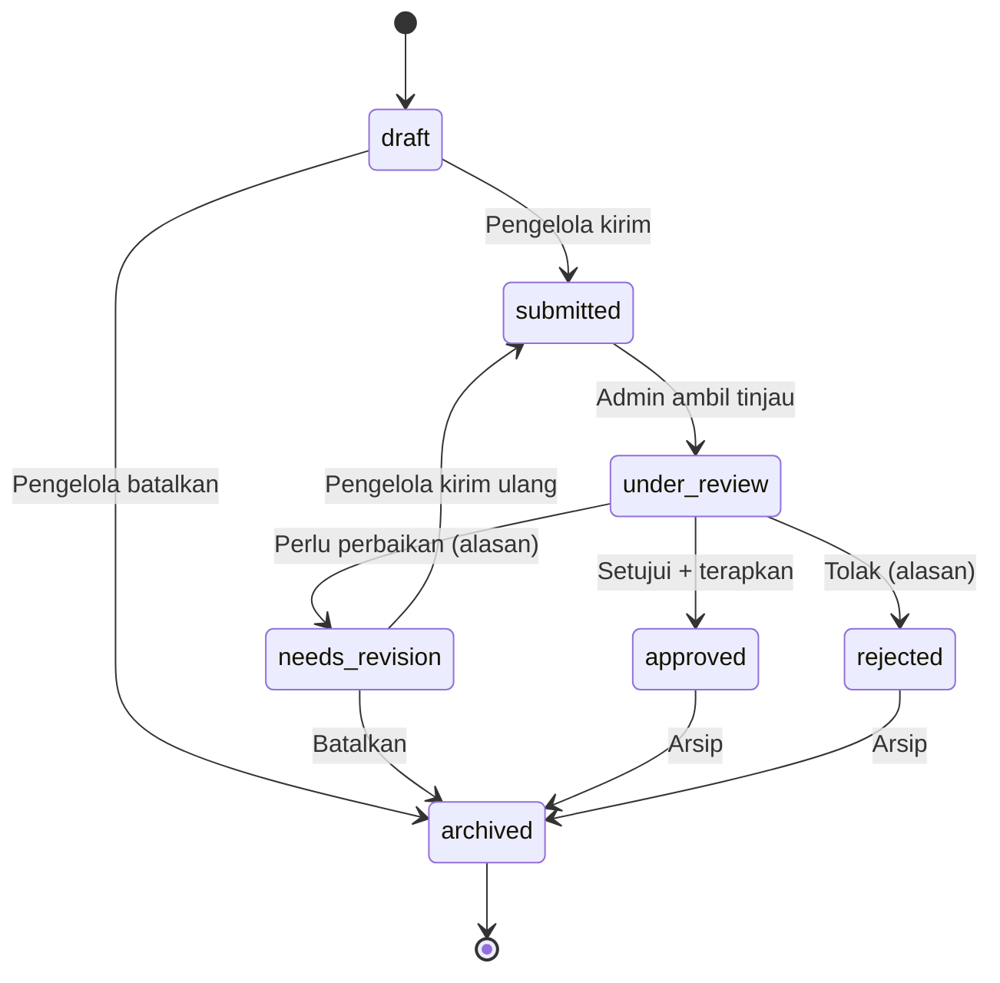
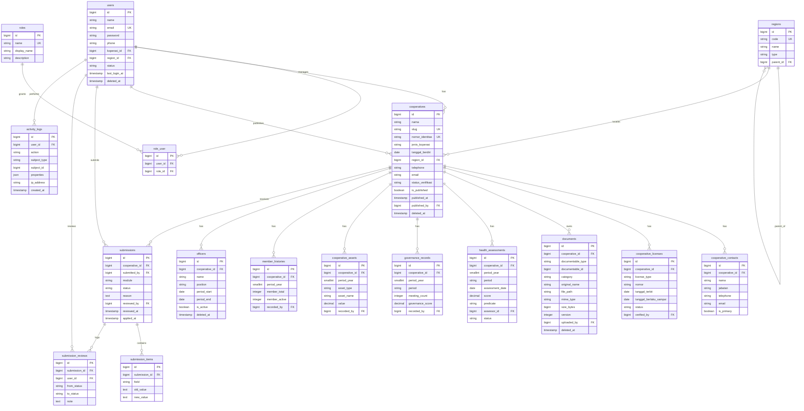

# Product Requirements Document (PRD)

## Sistem Informasi Pendataan dan Pemantauan Koperasi Provinsi Jawa Barat

| Field | Value |
| --- | --- |
| Nama Produk | Sistem Informasi Pendataan dan Pemantauan Koperasi Provinsi Jawa Barat |
| Instansi | Dinas Koperasi dan Usaha Kecil Provinsi Jawa Barat |
| Jenis Dokumen | Product Requirements Document (PRD) |
| Versi Dokumen | 1.0 (draft untuk konfirmasi pembimbing dinas) |
| Status | DRAFT — menunggu konfirmasi pihak dinas (lihat §21) |
| Disusun oleh | Mahasiswa Kerja Praktik (Teknik Informatika) sebagai Senior PM / System Analyst / Software Architect / Tech Lead |
| Tanggal | 15 Oktober 2026 |
| Konteks | Dokumen ini adalah *kontrak kebutuhan* untuk implementasi bertahap menggunakan OpenCode, Laravel, Blade, Tailwind CSS, dan MySQL. |

> **Cara membaca dokumen ini.** Label **[FAKTA]** menandai hal yang telah diberikan dalam konteks proyek. Label **[ASUMSI]** menandai asumsi sementara yang dibuat agar analisis dapat berjalan. Label **[REKOMENDASI]** menandai usulan teknis dari penyusun. Label **[PROPOSED]** menandai target kuantitatif yang belum disepakati. Label **[NEEDS CONFIRMATION]** menandai hal yang wajib dikonfirmasi kepada pembimbing dinas. Semua [ASUMSI] dan [PROPOSED] **bukan** keputusan final.

---

## Daftar Isi

1. [Ringkasan Eksekutif](#1-ringkasan-eksekutif)
2. [Latar Belakang dan Permasalahan](#2-latar-belakang-dan-permasalahan)
3. [Tujuan Produk](#3-tujuan-produk)
4. [Sasaran Pengguna dan Persona](#4-sasaran-pengguna-dan-persona)
5. [Ruang Lingkup dan Non-Scope](#5-ruang-lingkup-dan-non-scope)
6. [Asumsi dan Batasan](#6-asumsi-dan-batasan)
7. [Daftar Kebutuhan Fungsional](#7-daftar-kebutuhan-fungsional)
8. [Matriks Hak Akses](#8-matriks-hak-akses)
9. [User Stories](#9-user-stories)
10. [Acceptance Criteria](#10-acceptance-criteria)
11. [Aturan Bisnis](#11-aturan-bisnis)
12. [Workflow Pengajuan dan Verifikasi](#12-workflow-pengajuan-dan-verifikasi)
13. [Arsitektur Sistem](#13-arsitektur-sistem)
14. [Rancangan Basis Data dan ERD](#14-rancangan-basis-data-dan-erd)
15. [Persyaratan UI/UX](#15-persyaratan-uiux)
16. [Persyaratan Keamanan](#16-persyaratan-keamanan)
17. [Persyaratan Non-Fungsional](#17-persyaratan-non-fungsional)
18. [Strategi Pengujian](#18-strategi-pengujian)
19. [Rencana MVP dan Roadmap Implementasi](#19-rencana-mvp-dan-roadmap-implementasi)
20. [Risiko dan Mitigasi](#20-risiko-dan-mitigasi)
21. [Daftar Pertanyaan yang Perlu Dikonfirmasi](#21-daftar-pertanyaan-yang-perlu-dikonfirmasi)
22. [Definisi Selesai (Definition of Done)](#22-definisi-selesai-definition-of-done)

---

## 1. Ringkasan Eksekutif

Dinas Koperasi dan Usaha Kecil Provinsi Jawa Barat membutuhkan satu sistem informasi terpusat untuk **mendata**, **memutakhirkan**, **memverifikasi**, dan **memantau** data koperasi di wilayah Jawa Barat, sekaligus menyediakan **direktori publik** berisi informasi koperasi yang telah disetujui untuk dipublikasikan. Saat ini data koperasi dikelola secara terpisah dan belum tentu konsisten antar dokumen, sehingga menyulitkan pemantauan dan pelaporan. **[FAKTA]**

Produk yang diusulkan adalah aplikasi web monolitik modular berbasis **Laravel** (render server-side dengan **Blade**) yang melayani tiga kelompok pengguna: **Admin Dinas**, **Pengelola Koperasi**, dan **Masyarakat**. Sistem memusatkan data identitas koperasi, perizinan, kesehatan, tata kelola, aset, keanggotaan, pengurus, kontak, dokumen pendukung, dan riwayat perubahan, dengan **alur verifikasi berjenjang** sebelum data menjadi resmi dan/atau dipublikasikan. **[FAKTA]**

Karena kondisi basis data existing dinas **belum diketahui**, tahap awal produk mencakup **proses penemuan dan validasi data** (data discovery) sebagai bagian dari analisis kebutuhan, bukan asumsi bahwa data sudah tersedia dalam Excel/API tertentu. **[FAKTA]**

Dokumen ini menjadi acuan tunggal untuk implementasi bertahap. Kisaran MVP ditetapkan pada §19 dan penuh dengan kriteria penerimaan yang dapat diuji pada §10 dan §18.

### Nilai bisnis yang diharapkan

- Efisiensi pendataan dan pemutakhiran data koperasi (menggantikan pencatatan tersebar). **[ASUMSI]**
- Konsistensi data melalui validasi terpusat dan audit trail. **[ASUMSI]**
- Akuntabilitas proses verifikasi (setiap perubahan berstatus & berjejak). **[ASUMSI]**
- Transparansi publik terbatas pada informasi yang disetujui. **[FAKTA]**

---

## 2. Latar Belakang dan Permasalahan

### 2.1 Latar belakang **[FAKTA]**

Proyek berasal dari kebutuhan yang disampaikan pembimbing lapangan selama kegiatan kerja praktik mahasiswa Teknik Informatika semester 7. Data koperasi meliputi identitas, izin usaha, izin usaha simpan pinjam, kesehatan, tata kelola, aset, jumlah anggota, pengurus, kontak, dan dokumen pendukung. Kondisi basis data yang dimiliki dinas belum diketahui.

### 2.2 Rumusan masalah

| Kode | Permasalahan | Dampak | Basis |
| --- | --- | --- | --- |
| PB-01 | Data koperasi tersebar dan tidak terpusat | Sulit dipantau & dilaporkan | **[FAKTA]** |
| PB-02 | Pemutakhiran data tidak terkontrol | Data usang/inkonsisten | **[ASUMSI]** |
| PB-03 | Tidak ada mekanisme verifikasi yang berjejak | Sulit mempertanggungjawabkan data resmi | **[ASUMSI]** |
| PB-04 | Data historis (aset, anggota, kesehatan, tata kelola) tidak berbeda per periode | Analisis tren tidak mungkin | **[ASUMSI]** |
| PB-05 | Masyarakat tidak punya akses terkurasi ke informasi koperasi | Transparansi rendah | **[FAKTA]** |
| PB-06 | Tidak diketahui format/sumber data existing | Risiko desain skema yang salah | **[FAKTA]** |

### 2.3 Peluang

- Satu sumber kebenaran (single source of truth) untuk data koperasi. **[ASUMSI]**
- Kontrol publikasi informasi per koperasi. **[FAKTA]**
- Laporan dan rekapitulasi yang dapat dihasilkan cepat dari data terverifikasi. **[FAKTA]**

---

## 3. Tujuan Produk

| Kode | Tujuan | Indikator keberhasilan (PROPOSED) | Sumber |
| --- | --- | --- | --- |
| TP-01 | Memusatkan data koperasi dalam satu sistem | 100% koperasi target terdaftar dalam sistem | **[FAKTA]** |
| TP-02 | Mempermudah pengelolaan & pemutakhiran data | Pengelola dapat mengajukan perubahan tanpa bantuan admin | **[FAKTA]** |
| TP-03 | Mendukung pemantauan kondisi koperasi | Dashboard menampilkan status & rekap per wilayah/periode | **[FAKTA]** |
| TP-04 | Menyediakan informasi publik yang disetujui | Direktori publik hanya menampilkan data berstatus dipublikasikan | **[FAKTA]** |
| TP-05 | Mengurangi inkonsistensi & mempermudah laporan | Laporan dapat dihasilkan dari sistem tanpa rekonsiliasi manual | **[FAKTA]** |

### 3.1 Tujuan non-produk (outcome)

- Menjaga kerahasiaan data pribadi dan dokumen sensitif koperasi. **[FAKTA]**
- Mematuhi praktik pemerintahan: least privilege, audit trail, kontrol perubahan. **[REKOMENDASI]**

---

## 4. Sasaran Pengguna dan Persona

### 4.1 Ringkasan pengguna **[FAKTA]**

| Kelompok | Deskripsi | Login? | Cakupan Data |
| --- | --- | --- | --- |
| Admin Dinas | Petugas dinas yang mengelola & memverifikasi data | Ya | Sesuai kewenangan (provinsi/kab-kota) |
| Pengelola Koperasi | Perwakilan koperasi yang memperbarui data koperasinya | Ya | Hanya koperasi yang dikaitkan dengan akunnya |
| Masyarakat | Pengunjung umum | Tidak (guest) | Hanya informasi yang dipublikasikan |

### 4.2 Persona

**P1 — Rani, Admin/Verifikator Dinas.** **[ASUMSI]** Bekerja dengan banyak pengajuan tiap hari. Butuh daftar pengajuan yang jelas, filter berdasarkan status/wilayah, dan aksi cepat (setujui/perlu perbaikan/tolak dengan alasan). Tidak teknis; mengutamakan kecepatan & kejelasan status.

**P2 — Dedi, Pengelola Koperasi.** **[ASUMSI]** Mengurus administrasi koperasi serabutan; akses dari laptop/ponsel. Butuh form yang jelas, bisa disimpan sebagai draft, dan tahu persis bagian mana yang perlu diperbaiki jika ditolak.

**P3 — Sari, Masyarakat.** **[ASUMSI]** Ingin mencari koperasi berdasarkan nama/jenis/wilayah untuk keperluan usaha atau penelitian. Tidak ingin registrasi; menginginkan pencarian cepat dan halaman jelas.

**P4 — Pak Bagus, Pimpinan/Kepala Bidang (viewer).** **[ASUMSI]/[REKOMENDASI]** Ingin melihat statistik agregat & laporan, tidak mengubah transaksi harian. (Peran ini direkomendasikan, lihat §8.)

### 4.3 Kebutuhan kunci per persona

| Persona | Butuh | Ukuran nyaman |
| --- | --- | --- |
| P1 | Antrian verifikasi, pencarian cepat, audit | Aksi terbanyak ≤ 3 klik dari daftar |
| P2 | Form bertahap, autosave draft, pesan error jelas | Selesai satu modul tanpa bantuan |
| P3 | Pencarian & filter publik, halaman ringan | Hasil muncul < 2 detik **[PROPOSED]** |
| P4 | Rekap & ekspor | Laporan siap tanpa rekonsiliasi manual |

---

## 5. Ruang Lingkup dan Non-Scope

### 5.1 In-scope (MVP + fase lanjutan)

- Autentikasi, sesi, dan otorisasi berbasis peran. **[FAKTA]**
- Manajemen data induk koperasi. **[FAKTA]**
- Perizinan (izin usaha & izin usaha simpan pinjam) dan dokumen pendukung. **[FAKTA]**
- Kesehatan, tata kelola, aset, keanggotaan, pengurus (berbasis periode). **[FAKTA]**
- Kontak koperasi. **[FAKTA]**
- Workflow pengajuan & verifikasi + riwayat. **[FAKTA]**
- Audit log & riwayat perubahan. **[FAKTA]**
- Pencarian, filter, pagination, pengurutan. **[FAKTA]**
- Laporan, rekapitulasi, dan ekspor (jika dibutuhkan). **[FAKTA]**
- Direktori & statistik publik + kontrol publikasi. **[FAKTA]**
- Validasi, penanganan error, notifikasi status pengajuan (in-app). **[FAKTA]**

### 5.2 Non-scope (MVP) — tempatkan ke fase lanjutan atau di luar proyek

- Integrasi dengan sistem pemerintah lain / API eksternal (kecuali terbukti dibutuhkan & disetujui). **[FAKTA]**
- Aplikasi mobile native. **[ASUMSI]**
- Notifikasi berjenjang kompleks (multi-channel: SMS/WhatsApp/email massal). **[FAKTA]**
- Analitik lanjutan / business intelligence / machine learning. **[FAKTA]**
- SPA terpisah (React/Vue) — kecuali ada alasan teknis kuat & disetujui. **[FAKTA]**
- Single Sign-On lintas instansi. **[ASUMSI]**
- Multi-bahasa (i18n). **[ASUMSI]**
- Tanda tangan digital / e-signature bersertifikat. **[ASUMSI]**
- Migrasi otomatis data existing (bergantung hasil penemuan data). **[FAKTA]**
- Publikasi API terbuka untuk pihak ketiga. **[ASUMSI]**

### 5.3 Batasan proyek

- Dikerjakan sebagai proyek kerja praktik (waktu & tenaga terbatas). **[FAKTA]**
- Deployment/infrastruktur dinas belum diketahui. **[FAKTA]**
- Aturan hukum & prosedur resmi penilaian kesehatan **tidak boleh dikarang**. **[FAKTA]**

---

## 6. Asumsi dan Batasan

### 6.1 Fakta yang telah diberikan **[FAKTA]**

1. Produk: Sistem Informasi Pendataan dan Pemantauan Koperasi Provinsi Jawa Barat.
2. Instansi: Dinas Koperasi dan Usaha Kecil Provinsi Jawa Barat.
3. Tiga kelompok pengguna: Admin Dinas, Pengelola Koperasi, Masyarakat.
4. Jenis data yang dikelola (lihat §5.1).
5. Stack: Laravel + PHP, Blade, Tailwind CSS, JS seperlunya, MySQL, Git, dev lokal.
6. Basis data existing dinas belum diketahui.
7. Fokus pendekatan: Blade (bukan SPA) kecuali ada alasan kuat.

### 6.2 Asumsi sementara **[ASUMSI]** — perlu divalidasi

| Kode | Asumsi | Risiko jika salah |
| --- | --- | --- |
| A-01 | Koperasi teridentifikasi unik dengan nomor badan hukum/registrasi resmi | Perlu skema identitas tambahan |
| A-02 | Data kesehatan/aset/anggota dicatat per periode (tahunan) | Perlu granularitas periode berbeda |
| A-03 | Pembagian kewenangan admin mengikuti wilayah (provinsi & kab/kota) | Matriks akses berubah |
| A-04 | Publikasi bersifat opt-in per koperasi (default tidak dipublikasikan) | Perubahan default publikasi |
| A-05 | Satu akun pengelola terhubung ke tepat satu koperasi | Perlu relasi many-to-many akun–koperasi |
| A-06 | Dokumen pendukung disimpan di storage privat lokal server | Perlu object storage |
| A-07 | Notifikasi cukup in-app (bell/daftar) untuk MVP | Perlu email/SMS |
| A-08 | Zona waktu Asia/Jakarta, satu bahasa (Indonesia) | Perubahan i18n/TZ |

### 6.3 Rekomendasi teknis **[REKOMENDASI]**

- Laravel 13.x + PHP 8.4 + Blade + Tailwind CSS v4.3 + MySQL 8.x (lihat §13 untuk verifikasi versi).
- Monolit modular sederhana, Form Request Validation, Policies/Gates, opsional Services hanya bila ada logika lintas-entitas.
- Soft delete untuk data penting, storage privat untuk dokumen, audit log untuk perubahan sensitif.

### 6.4 Pertanyaan yang perlu dikonfirmasi **[NEEDS CONFIRMATION]**

Lihat daftar lengkap berprioritas di §21.

---

## 7. Daftar Kebutuhan Fungsional

### 7.1 Prinsip pemberian ID

- `FR-###` untuk kebutuhan fungsional, unik dan stabil.
- Setiap FR memiliki: **Tujuan, Aktor, Data Masukan, Proses Bisnis, Hasil, Validasi, Kondisi Gagal, Dependensi, Kriteria Penerimaan**, plus label fase **MVP** atau **FASE-2/3**.

### 7.2 Matriks kebutuhan fungsional (ringkas)

| ID | Modul | Ringkasan | Aktor | Fase |
| --- | --- | --- | --- | --- |
| FR-001 | Autentikasi | Login dengan email + password | Admin, Pengelola | MVP |
| FR-002 | Autentikasi | Logout & invalidasi sesi | Admin, Pengelola | MVP |
| FR-003 | Autentikasi | Manajemen sesi (remember, batas waktu, paksa logout) | Admin, Pengelola | MVP |
| FR-004 | Autentikasi | Reset password | Admin, Pengelola | MVP |
| FR-010 | Otorisasi | RBAC via middleware + Policy/Gate | Semua | MVP |
| FR-011 | Otorisasi | Isolasi data per koperasi (anti-IDOR) | Pengelola | MVP |
| FR-012 | Otorisasi | Pembatasan admin berdasarkan wilayah (jika diaktifkan) | Admin | FASE-2 |
| FR-020 | Dashboard Admin | Statistik koperasi per status/wilayah/periode | Admin | MVP |
| FR-021 | Dashboard Admin | Antrian pengajuan yang perlu ditindak | Admin | MVP |
| FR-022 | Dashboard Admin | Ringkasan perizinan & kesehatan | Admin | FASE-2 |
| FR-030 | Dashboard Pengelola | Status kelengkapan & pengajuan koperasi | Pengelola | MVP |
| FR-031 | Dashboard Pengelola | Daftar permintaan perbaikan | Pengelola | MVP |
| FR-040 | Data Induk | CRUD data induk koperasi | Admin | MVP |
| FR-041 | Data Induk | Pengelola melihat profil koperasinya | Pengelola | MVP |
| FR-042 | Data Induk | Pengelola mengusulkan perubahan data induk | Pengelola | MVP |
| FR-043 | Data Induk | Pengarsipan/nonaktifkan koperasi (soft delete) | Admin | MVP |
| FR-050 | Izin Usaha | CRUD izin usaha koperasi | Admin, Pengelola (usul) | MVP |
| FR-051 | Izin Usaha | Verifikasi izin usaha | Admin | MVP |
| FR-060 | Izin Simpan Pinjam | CRUD izin usaha simpan pinjam | Admin, Pengelola (usul) | MVP |
| FR-061 | Izin Simpan Pinjam | Verifikasi izin simpan pinjam | Admin | MVP |
| FR-070 | Dokumen | Unggah dokumen pendukung | Admin, Pengelola | MVP |
| FR-071 | Dokumen | Unduh dokumen dengan otorisasi | Admin, Pengelola (miliknya) | MVP |
| FR-072 | Dokumen | Kelola versi & pengarsipan dokumen | Admin | FASE-2 |
| FR-080 | Kesehatan | Catat hasil penilaian kesehatan per periode (kewenangan admin) | Admin | MVP |
| FR-081 | Kesehatan | Pengelola melihat riwayat kesehatan koperasinya | Pengelola | MVP |
| FR-082 | Kesehatan | Perhitungan skor/predikat otomatis (jika ada formula resmi) | Admin | FASE-2/NEEDS CONFIRMATION |
| FR-090 | Tata Kelola | Catat data tata kelola per periode | Admin, Pengelola (usul) | MVP |
| FR-091 | Tata Kelola | Evaluasi kepatuhan tata kelola | Admin | FASE-2 |
| FR-100 | Aset | Catat aset per periode | Admin, Pengelola (usul) | MVP |
| FR-101 | Aset | Riwayat aset antar periode | Admin, Pengelola | MVP |
| FR-110 | Anggota | Catat jumlah anggota per periode | Admin, Pengelola (usul) | MVP |
| FR-111 | Anggota | Riwayat keanggotaan | Admin, Pengelola | MVP |
| FR-120 | Pengurus | CRUD susunan pengurus & periode jabatan | Admin, Pengelola (usul) | MVP |
| FR-121 | Pengurus | Status aktif/nonaktif pengurus | Admin, Pengelola (usul) | MVP |
| FR-130 | Kontak | Kelola telepon/email/website koperasi | Admin, Pengelola (usul) | MVP |
| FR-140 | Workflow | Membuat & mengirim pengajuan | Pengelola, Admin | MVP |
| FR-141 | Workflow | Meninjau & memutuskan pengajuan | Admin | MVP |
| FR-142 | Workflow | Permintaan perbaikan & penolakan beralasan | Admin | MVP |
| FR-143 | Workflow | Menerapkan perubahan ke data resmi saat disetujui | Sistem/Admin | MVP |
| FR-150 | Riwayat | Riwayat perubahan data (field-level) | Admin | MVP |
| FR-151 | Riwayat | Audit log aktivitas pengguna | Admin | MVP |
| FR-160 | Pencarian | Pencarian, filter, pagination, pengurutan | Semua | MVP |
| FR-170 | Laporan | Laporan & rekapitulasi koperasi | Admin | MVP |
| FR-171 | Ekspor | Ekspor CSV/Excel/PDF (sesuai izin) | Admin | FASE-2 |
| FR-180 | Publik | Direktori koperasi terpublikasi | Masyarakat | MVP |
| FR-181 | Publik | Pencarian & filter publik | Masyarakat | MVP |
| FR-182 | Publik | Profil publik koperasi | Masyarakat | MVP |
| FR-183 | Publik | Statistik agregat publik | Masyarakat | FASE-2 |
| FR-190 | Publikasi | Kontrol status publikasi | Admin | MVP |
| FR-191 | Publikasi | Pengaturan informasi yang boleh tampil | Admin | MVP |
| FR-200 | Validasi | Validasi input & pesan error dekat field | Semua | MVP |
| FR-201 | Notifikasi | Notifikasi status pengajuan (in-app) | Admin, Pengelola | MVP |

### 7.3 Detail kebutuhan fungsional

> Format ringkas. Setiap blok memuat 9 atribut wajib. Dependensi menggunakan ID modul/FR lain.

#### Modul 1 — Autentikasi, Logout, Manajemen Sesi

**FR-001 — Login**
- **Tujuan:** Memberi akses internal bagi Admin & Pengelola.
- **Aktor:** Admin Dinas, Pengelola Koperasi.
- **Data Masukan:** email, password, opsi *remember me*.
- **Proses:** Validasi kredensial → cek status akun aktif → buat sesi → catat aktivitas login → arahkan ke dashboard sesuai peran.
- **Hasil:** Sesi aktif; pengguna diarahkan ke dashboard perannya.
- **Validasi:** email format & wajib; password wajib; akun harus `active`; kredensial benar.
- **Kondisi Gagal:** kredensial salah → pesan generik "Email atau password salah" (tidak membocorkan keberadaan akun); akun nonaktif → pesan "Akun dinonaktifkan, hubungi admin"; rate limit terlampaui → pesan coba lagi nanti.
- **Dependensi:** FR-010 (peran), data `users`.
- **Kriteria Penerimaan:** (a) login valid mengarah ke dashboard sesuai peran; (b) login tidak valid menampilkan pesan generik tanpa membocorkan akun; (c) percobaan berulang dibatasi rate limiter; (d) semua kolom terisi tervalidasi.

**FR-002 — Logout**
- **Tujuan:** Mengakhiri sesi dengan aman.
- **Aktor:** Admin, Pengelola.
- **Data Masukan:** aksi logout.
- **Proses:** invalidasi sesi, regenerasi token CSRF, catat aktivitas.
- **Hasil:** Sesi berakhir, kembali ke halaman login/publik.
- **Validasi:** permintaan logout hanya POST dengan CSRF valid.
- **Kondisi Gagal:** token CSRF tidak valid → 419.
- **Dependensi:** FR-001.
- **Kriteria Penerimaan:** setelah logout, menekan tombol back tidak membuka halaman terautentikasi; sesi tidak dapat dipakai ulang.

**FR-003 — Manajemen Sesi**
- **Tujuan:** Mengendalikan umur sesi & perangkat.
- **Aktor:** Admin (kebijakan), pengguna.
- **Data Masukan:** konfigurasi sesi; daftar sesi aktif.
- **Proses:** terapkan masa berlaku idle/timeout, dukung *remember me*, sediakan aksi "keluar dari semua perangkat".
- **Hasil:** Sesi terkendali.
- **Validasi:** konfigurasi hanya dapat diubah admin.
- **Kondisi Gagal:** sesi kedaluwarsa → arahkan ke login dengan pesan.
- **Dependensi:** FR-001, NFR-SEC.
- **Kriteria Penerimaan:** sesi idle melewati batas waktu **PROPOSED** memaksa login ulang.

**FR-004 — Reset Password**
- **Tujuan:** Pemulihan akses tanpa intervensi manual (untuk email aktif) **atau** via admin (jika email belum tersedia).
- **Aktor:** pengguna (self-service), Admin (reset paksa).
- **Data Masukan:** email, token reset, password baru, konfirmasi.
- **Proses:** kirim tautan reset (self-service) **atau** admin menghasilkan password sementara yang wajib diganti saat login pertama.
- **Hasil:** Password diperbarui; semua sesi lama diinvalidasi.
- **Validasi:** kekuatan password minimum; token berlaku terbatas; konfirmasi cocok.
- **Kondisi Gagal:** token kedaluwarsa → minta ulang; email tidak terdaftar → pesan generik.
- **Dependensi:** FR-001, mailer **[NEEDS CONFIRMATION]**.
- **Kriteria Penerimaan:** setelah reset, password lama tidak dapat digunakan; password disimpan sebagai hash.

#### Modul 2 — Otorisasi Berbasis Peran

**FR-010 — RBAC**
- **Tujuan:** Membatasi akses berdasarkan peran.
- **Aktor:** semua.
- **Data Masukan:** peran pengguna, rute, aksi.
- **Proses:** middleware `auth` + `role`, Policy/Gate pada setiap aksi; verifikasi di server.
- **Hasil:** Hanya peran berwenang yang dapat mengakses fitur.
- **Validasi:** setiap route internal terlindungi middleware; setiap model memiliki Policy.
- **Kondisi Gagal:** akses tidak sah → 403 (bukan 404 menyesatkan **kecuali** untuk menyembunyikan keberadaan resource).
- **Dependensi:** tabel `users`, `roles`, `role_user`.
- **Kriteria Penerimaan:** pengelola tidak dapat mengakses route admin meski menebak URL; tombol tersembunyi **dan** server menolak.

**FR-011 — Isolasi data per koperasi (anti-IDOR)**
- **Tujuan:** Mencegah akses lintas koperasi.
- **Aktor:** Pengelola.
- **Data Masukan:** parameter resource (id koperasi/dokumen/aset).
- **Proses:** scope query berdasarkan `user.koperasi_id`; Policy memverifikasi kepemilikan pada setiap operasi.
- **Hasil:** Pengelola hanya melihat/mengubah data koperasinya.
- **Validasi:** tidak pernah memercayai id dari klien.
- **Kondisi Gagal:** id koperasi lain → 403/404 dan dicatat sebagai percobaan akses.
- **Dependensi:** FR-010, data relasi akun–koperasi.
- **Kriteria Penerimaan:** mengganti id pada URL tidak membuka data koperasi lain.

**FR-012 — Pembatasan admin per wilayah (REKOMENDASI, FASE-2)** **[NEEDS CONFIRMATION]**
- **Tujuan:** Membatasi kewenangan admin berdasarkan kabupaten/kota jika dinas menerapkan desentralisasi.
- **Aktor:** Admin.
- **Data Masukan:** pemetaan user–wilayah.
- **Proses:** filter query & Policy berdasarkan `region_id` user.
- **Hasil:** Admin hanya melihat koperasi di wilayahnya (kecuali super admin).
- **Validasi:** wilayah wajib bila mode ini aktif.
- **Kondisi Gagal:** di luar wilayah → 403.
- **Dependensi:** `regions`, kebijakan dinas.
- **Kriteria Penerimaan:** admin wilayah A tidak melihat data wilayah B; super admin melihat semua.

#### Modul 3 — Dashboard Admin Dinas

**FR-020 — Statistik koperasi**
- **Tujuan:** Memberi gambaran kondisi koperasi.
- **Aktor:** Admin.
- **Data Masukan:** filter wilayah/periode/status.
- **Proses:** agregasi jumlah koperasi per status verifikasi, per kab/kota, per jenis, tren.
- **Hasil:** Kartu statistik & grafik ringkas.
- **Validasi:** filter tervalidasi; angka konsisten dengan daftar.
- **Kondisi Gagal:** tidak ada data → empty state informatif.
- **Dependensi:** data koperasi, referensi wilayah.
- **Kriteria Penerimaan:** angka kartu sama dengan hasil query daftar yang setara.

**FR-021 — Antrian pengajuan**
- **Tujuan:** Menyediakan daftar pengajuan yang perlu ditindak.
- **Aktor:** Admin.
- **Data Masukan:** filter status/umur pengajuan.
- **Proses:** daftar pengajuan berstatus `submitted`/`under_review`.
- **Hasil:** Daftar dengan aksi cepat.
- **Validasi:** hanya pengajuan dalam kewenangan.
- **Kondisi Gagal:** kosong → empty state.
- **Dependensi:** FR-140/141.
- **Kriteria Penerimaan:** daftar menampilkan aksi yang valid untuk status saat ini.

**FR-022 — Ringkasan perizinan & kesehatan (FASE-2)**
- **Tujuan:** Pemantauan izin kadaluarsa & distribusi kesehatan.
- **Aktor:** Admin.
- **Data Masukan:** periode, wilayah.
- **Proses:** agregasi status izin & predikat kesehatan.
- **Hasil:** Widget ringkasan.
- **Validasi:** hanya data terverifikasi.
- **Kondisi Gagal:** data kurang → tampilkan apa adanya dengan keterangan.
- **Dependensi:** FR-050/060/080.
- **Kriteria Penerimaan:** izin mendekati kadaluarsa terdaftar sesuai definisi interval **[NEEDS CONFIRMATION]**.

#### Modul 4 — Dashboard Pengelola Koperasi

**FR-030 — Status kelengkapan**
- **Tujuan:** Menunjukkan kelengkapan data & status pengajuan.
- **Aktor:** Pengelola.
- **Data Masukan:** data koperasinya.
- **Proses:** hitung kelengkapan per modul; tampilkan status pengajuan terkini.
- **Hasil:** Indikator kelengkapan & daftar aksi.
- **Validasi:** hanya koperasi milik akun.
- **Kondisi Gagal:** belum ada data → panduan pengisian.
- **Dependensi:** FR-041/140.
- **Kriteria Penerimaan:** indikator konsisten dengan kelengkapan field wajib.

**FR-031 — Daftar permintaan perbaikan**
- **Tujuan:** Menampilkan pengajuan yang perlu diperbaiki beserta alasan.
- **Aktor:** Pengelola.
- **Data Masukan:** pengajuan berstatus `needs_revision`/`rejected`.
- **Proses:** daftar + alasan + tautan revisi.
- **Hasil:** Aksi memperbaiki & mengirim ulang.
- **Validasi:** hanya milik koperasi.
- **Kondisi Gagal:** tidak ada → empty state.
- **Dependensi:** FR-142.
- **Kriteria Penerimaan:** alasan penolakan terlihat dan revisi membuat pengajuan terpisah.

#### Modul 5 — Manajemen Data Induk Koperasi

**FR-040 — CRUD data induk (Admin)**
- **Tujuan:** Mengelola entitas koperasi.
- **Aktor:** Admin.
- **Data Masukan:** nama, nomor identitas resmi, jenis, bentuk, wilayah, alamat, tanggal berdiri, status, dsb.
- **Proses:** tambah/lihat/ubah/arsipkan.
- **Hasil:** Data induk tersimpan & berjejak.
- **Validasi:** field wajib; format nomor identitas sesuai sumber resmi **[NEEDS CONFIRMATION]**; region valid.
- **Kondisi Gagal:** duplikat nomor identitas → tolak dengan pesan; validasi gagal → kembali ke form.
- **Dependensi:** `regions`, FR-150.
- **Kriteria Penerimaan:** nomor identitas unik; perubahan tercatat di audit log.

**FR-041 — Profil koperasi (Pengelola, read)**
- **Tujuan:** Pengelola melihat data koperasi terdaftar.
- **Aktor:** Pengelola.
- **Data Masukan:** —
- **Proses:** tampilkan data resmi + status.
- **Hasil:** Halaman profil read-only + tautan usul perubahan.
- **Validasi:** kepemilikan akun–koperasi.
- **Kondisi Gagal:** akun belum dikaitkan → halaman khusus "akun belum terhubung".
- **Dependensi:** FR-011.
- **Kriteria Penerimaan:** hanya koperasi milik akun yang tampil.

**FR-042 — Usul perubahan data induk (Pengelola)**
- **Tujuan:** Mengajukan perubahan tanpa mengubah data resmi langsung.
- **Aktor:** Pengelola.
- **Data Masukan:** field yang diubah + dokumen pendukung (jika perlu).
- **Proses:** buat pengajuan terpisah (lihat §12).
- **Hasil:** Pengajuan dibuat & dapat dikirim.
- **Validasi:** field yang diizinkan pengelola **[NEEDS CONFIRMATION]**; validasi per-field.
- **Kondisi Gagal:** field terlarang → tolak; draft tidak lengkap → simpan sebagai draft.
- **Dependensi:** FR-140, BR-009.
- **Kriteria Penerimaan:** data resmi **tidak** berubah sebelum disetujui.

**FR-043 — Arsip/nonaktifkan koperasi**
- **Tujuan:** Menonaktifkan tanpa menghapus fisik.
- **Aktor:** Admin.
- **Data Masukan:** alasan penghapusan/arsip.
- **Proses:** soft delete + set status arsip.
- **Hasil:** Data tersembunyi dari daftar aktif namun tetap tersimpan.
- **Validasi:** aksi terbatas admin; wajib alasan.
- **Kondisi Gagal:** tidak berwenang → 403.
- **Dependensi:** BR-011.
- **Kriteria Penerimaan:** data terarsip tidak muncul di direktori publik & daftar aktif.

#### Modul 6 & 7 — Perizinan (Izin Usaha & Izin Usaha Simpan Pinjam)

**FR-050 — CRUD izin usaha**
- **Tujuan:** Mencatat legalitas izin usaha.
- **Aktor:** Admin (penuh), Pengelola (usul).
- **Data Masukan:** jenis izin, nomor, tanggal terbit, tanggal berlaku s/d, penerbit, status, dokumen.
- **Proses:** CRUD + unggah dokumen + verifikasi.
- **Hasil:** Data izin tersimpan & terverifikasi.
- **Validasi:** nomor format **[NEEDS CONFIRMATION]**; tanggal berlaku > tanggal terbit; dokumen sesuai jenis.
- **Kondisi Gagal:** nomor duplikat → tolak; tanggal tidak logis → tolak.
- **Dependensi:** FR-070, FR-141.
- **Kriteria Penerimaan:** izin kadaluarsa dapat diidentifikasi berdasarkan tanggal.

**FR-051 — Verifikasi izin usaha** — Aktor admin; proses ubah status verifikasi + catatan; hasil tersimpan; kriteria: status hanya berubah oleh admin berwenang.

**FR-060 — CRUD izin usaha simpan pinjam** dan **FR-061 — Verifikasi izin simpan pinjam** — analog FR-050/051 dengan field khusus simpan pinjam (mis. ruang lingkup simpan pinjam) **[NEEDS CONFIRMATION]**.

#### Modul 8 — Pengelolaan Dokumen Pendukung

**FR-070 — Unggah dokumen**
- **Tujuan:** Menyimpan bukti/legalitas.
- **Aktor:** Admin, Pengelola.
- **Data Masukan:** berkas (pdf/jpg/png), kategori, entitas terkait (izin/aset/dll).
- **Proses:** validasi tipe & ukuran → simpan ke storage privat → simpan metadata.
- **Hasil:** Metadata tersimpan, berkas di lokasi nonpublik.
- **Validasi:** whitelist MIME/ekstensi; batas ukuran **[PROPOSED: 5 MB]**; nama file di-*sanitize*.
- **Kondisi Gagal:** tipe/size tidak sesuai → pesan spesifik; upload gagal → simpan state form.
- **Dependensi:** NFR-SEC, storage.
- **Kriteria Penerimaan:** berkas **tidak** dapat diakses via URL langsung tanpa otorisasi.

**FR-071 — Unduh dokumen berotorisasi**
- **Tujuan:** Mengunduh dokumen hanya oleh pihak berwenang.
- **Aktor:** Admin, Pengelola (miliknya).
- **Data Masukan:** id dokumen.
- **Proses:** Policy → stream response dari storage privat.
- **Hasil:** Berkas terunduh bila berwenang.
- **Validasi:** kepemilikan & peran.
- **Kondisi Gagal:** tidak berwenang → 403; berkas hilang → 404 dengan pesan.
- **Dependensi:** FR-070/011.
- **Kriteria Penerimaan:** pengelola lain tidak dapat mengunduh dokumen koperasi berbeda.

**FR-072 — Versi & arsip dokumen (FASE-2)** — menyimpan versi baru tanpa menghapus versi lama; arsip dokumen usang.

#### Modul 9 — Penilaian Kesehatan

**FR-080 — Catat kesehatan (Admin)**
- **Tujuan:** Mencatat hasil penilaian kesehatan per periode.
- **Aktor:** Admin (kewenangan resmi).
- **Data Masukan:** periode (tahun, opsional semester **[NEEDS CONFIRMATION]**), komponen nilai, skor, predikat, tanggal penilaian, penilai, catatan.
- **Proses:** input nilai → (opsional) hitung skor/predikat → simpan per periode.
- **Hasil:** Catatan kesehatan terverifikasi per periode.
- **Validasi:** periode wajib & unik per koperasi+periode; nilai dalam rentang valid; formula (bila ada) resmi **[NEEDS CONFIRMATION]**.
- **Kondisi Gagal:** duplikat periode → tolak/arahkan revisi; nilai di luar rentang → tolak.
- **Dependensi:** BR-008, FR-082.
- **Kriteria Penerimaan:** riwayat kesehatan lintas periode dapat dibedakan; pengelola tidak dapat mengubahnya.

**FR-081 — Lihat kesehatan (Pengelola)** — read-only riwayat kesehatan koperasinya; kriteria: pengelola tidak dapat mengedit.

**FR-082 — Perhitungan otomatis (FASE-2/NEEDS CONFIRMATION)** — hanya jika formula resmi tersedia; tanpa formula, input manual oleh admin.

#### Modul 10 — Tata Kelola

**FR-090 — Catat tata kelola** — periode, indikator kepatuhan (mis. jumlah rapat), skor/ringkasan, catatan; admin penuh, pengelola usul.
**FR-091 — Evaluasi kepatuhan (FASE-2)** — tandai deviasi terhadap kriteria **[NEEDS CONFIRMATION]**; hasil evaluasi kewenangan admin.

#### Modul 11 — Aset & Periode

**FR-100 — Catat aset per periode** — jenis aset, nilai, keterangan, periode.
**FR-101 — Riwayat aset** — bandingkan antar periode tanpa menimpa.

#### Modul 12 — Jumlah Anggota

**FR-110 — Catat anggota per periode** — jumlah total, aktif, masuk, keluar, periode.
**FR-111 — Riwayat keanggotaan** — tren antar periode.

#### Modul 13 — Susunan Pengurus

**FR-120 — CRUD pengurus** — nama, jabatan, periode jabatan (mulai–selesai), no. identitas (opsional), status.
**FR-121 — Aktif/nonaktif pengurus** — tandai jabatan berakhir tanpa menghapus riwayat.

#### Modul 14 — Kontak

**FR-130 — Kelola kontak** — telepon, email, website (format email/URL); admin penuh, pengelola usul.

#### Modul 15 — Workflow Pengajuan & Verifikasi

**FR-140 — Buat & kirim pengajuan** — pilih modul & data; simpan draft; kirim untuk verifikasi; hasil: pengajuan berstatus `submitted`.
**FR-141 — Tinjau & putuskan** — admin membuka pengajuan, bandingkan usulan vs data resmi, putuskan: setujui / perlu perbaikan / tolak (wajib alasan untuk 2 terakhir).
**FR-142 — Perbaikan & penolakan** — alasan tampil ke pengelola; revisi membuat versi pengajuan baru (history terjaga).
**FR-143 — Terapkan perubahan** — saat disetujui, sistem menulis perubahan ke data resmi dalam transaksi DB + mencatat versi lama.

#### Modul 16 — Riwayat Perubahan & Audit Log

**FR-150 — Riwayat perubahan field-level** — siapa, kapan, dari nilai apa ke apa, pada entitas mana.
**FR-151 — Audit log aktivitas** — login, CRUD sensitif, perubahan status, unduh dokumen, ekspor; tidak dapat diubah dari UI.

#### Modul 17 — Pencarian, Filter, Pagination, Pengurutan

**FR-160 — Pencarian & filter** — pencarian teks, filter per kolom (status, wilayah, jenis, periode), pagination server-side, pengurutan aman (whitelist kolom).

#### Modul 18 & 19 — Laporan, Rekapitulasi, Ekspor

**FR-170 — Laporan & rekapitulasi** — rekap per wilayah/jenis/status/periode; hanya data terverifikasi.
**FR-171 — Ekspor (FASE-2)** — CSV/Excel/PDF sesuai izin; ekspor dicatat di audit log.

#### Modul 20 — Direktori & Statistik Publik

**FR-180 — Direktori publik** — hanya koperasi `is_published = true` dan status resmi.
**FR-181 — Pencarian & filter publik** — nama/jenis/kabupaten/kota.
**FR-182 — Profil publik** — field yang diizinkan saja.
**FR-183 — Statistik agregat publik (FASE-2)** — sesuai konfigurasi publikasi.

#### Modul 21 — Status Publikasi

**FR-190 — Kontrol publikasi** — admin mempublikasikan/menarik informasi koperasi.
**FR-191 — Pengaturan field publik** — menentukan field apa yang boleh tampil (mis. legalitas/kesehatan hanya jika diizinkan) **[NEEDS CONFIRMATION]**.

#### Modul 22 — Validasi, Error Handling, Notifikasi

**FR-200 — Validasi & error handling** — Form Request; pesan dekat field; halaman error 403/404/419/500 ramah.
**FR-201 — Notifikasi status (in-app)** — pemberitahuan saat pengajuan disetujui/perlu perbaikan/ditolak.

### 7.4 Prioritas MVP vs lanjutan (ringkasan)

- **MVP:** FR-001…004, 010, 011, 020, 021, 030, 031, 040…043, 050, 051, 060, 061, 070, 071, 080, 081, 090, 100, 101, 110, 111, 120, 121, 130, 140…143, 150, 151, 160, 170, 180…182, 190, 191, 200, 201.
- **FASE-2/3:** FR-012, 022, 072, 082, 091, 171, 183, dan lintas-periode analitik lanjutan.

---

## 8. Matriks Hak Akses

### 8.1 Peran

| Peran | Kode | Deskripsi | Status |
| --- | --- | --- | --- |
| Admin Dinas | `admin_dinas` | Pengelola & verifikator data | **[FAKTA]** |
| Pengelola Koperasi | `pengelola_koperasi` | Perwakilan koperasi | **[FAKTA]** |
| Masyarakat | `public` (guest) | Tanpa login | **[FAKTA]** |

**Sub-peran admin (REKOMENDASI — perlu persetujuan dinas):** **[NEEDS CONFIRMATION]**

| Sub-peran | Kode | Kewenangan |
| --- | --- | --- |
| Super Admin | `super_admin` | Semua + kelola akun & peran |
| Verifikator/Petugas Pendataan | `verifikator` | Input/edit + verifikasi |
| Operator Publikasi | `operator_publikasi` | Kontrol publikasi & direktori |
| Pimpinan (Viewer) | `pimpinan` | Baca + laporan, tanpa ubah transaksi |

> Sub-peran ini **tidak wajib** untuk MVP. Jika dinas tidak memerlukannya, cukup `admin_dinas` tunggal.

### 8.2 Matriks akses (ringkas)

Keterangan: **C**=Create, **R**=Read, **U**=Update, **D**=Delete/Arsip, **V**=Verifikasi/Approve, **P**=Publikasi, **–**=tidak berhak.

| Area | Admin Dinas | Pengelola Koperasi | Masyarakat |
| --- | --- | --- | --- |
| Dashboard internal | R | R (terbatas) | – |
| Data induk koperasi | C R U D | R (miliknya) + U via pengajuan | R (publik saja) |
| Izin usaha | C R U D V | R (miliknya) + usul | R jika dipublikasikan |
| Izin simpan pinjam | C R U D V | R (miliknya) + usul | R jika dipublikasikan |
| Dokumen pendukung | C R U D | C R (miliknya) | – |
| Kesehatan | C R U (resmi) | R (miliknya) | R jika diizinkan |
| Tata kelola | C R U | R + usul | R jika diizinkan |
| Aset | C R U | R + usul | – (default) |
| Jumlah anggota | C R U | R + usul | Ringkasan jika diizinkan |
| Pengurus | C R U D | R + usul | R jika diizinkan |
| Kontak | C R U | R + usul | R (kontak publik) |
| Workflow pengajuan | R V | C R (miliknya) | – |
| Audit log | R | – | – |
| Laporan & rekap | R + Ekspor | R (miliknya) | Statistik agregat (jika diizinkan) |
| Kontrol publikasi | P | – | – |
| Akun & peran | C R U D (super admin) | – | – |

### 8.3 Aturan otorisasi

- **[FAKTA]** Verifikasi hak akses dilakukan **di server**, bukan sekadar menyembunyikan tombol.
- **[FAKTA]** Pengelola hanya mengakses data koperasi yang dikaitkan dengan akunnya (anti-IDOR).
- **[FAKTA]** Masyarakat tidak boleh mengakses dashboard internal, dokumen terbatas, data pribadi, data belum terverifikasi, atau endpoint administrasi.
- **[REKOMENDASI]** Least privilege: berikan hak minimum yang cukup.

---

## 9. User Stories

> Format: **US-###**. Prioritas: **MoSCoW** (M=Must, S=Should, C=Could).

### Admin Dinas

| ID | User Story | Prioritas |
| --- | --- | --- |
| US-001 | Sebagai admin, saya ingin login agar dapat mengakses dashboard internal. | M |
| US-002 | Sebagai admin, saya ingin melihat statistik koperasi agar dapat memantau kondisi. | M |
| US-003 | Sebagai admin, saya ingin mencari & memfilter koperasi agar menemukan data dengan cepat. | M |
| US-004 | Sebagai admin, saya ingin membuat/mengubah data koperasi agar data terpusat. | M |
| US-005 | Sebagai admin, saya ingin memeriksa pengajuan agar dapat menyetujui/perbaikan/menolak. | M |
| US-006 | Sebagai admin, saya ingin memberi alasan penolakan agar pengelola tahu yang harus diperbaiki. | M |
| US-007 | Sebagai admin, saya ingin mencatat hasil penilaian kesehatan agar data resmi terdokumentasi. | M |
| US-008 | Sebagai admin, saya ingin melihat riwayat perubahan agar dapat menelusuri siapa mengubah apa. | M |
| US-009 | Sebagai admin, saya ingin mengelola akun pengelola agar akses terkendali. | M |
| US-010 | Sebagai admin, saya ingin membuat laporan & mengekspor data agar pelaporan lebih cepat. | S |
| US-011 | Sebagai admin, saya ingin menentukan informasi yang boleh dipublikasikan. | M |
| US-012 | Sebagai admin, saya ingin mengelola dokumen privat agar dokumen sensitif aman. | M |

### Pengelola Koperasi

| ID | User Story | Prioritas |
| --- | --- | --- |
| US-020 | Sebagai pengelola, saya ingin login ke akun koperasi saya. | M |
| US-021 | Sebagai pengelola, saya ingin melihat profil koperasi saya. | M |
| US-022 | Sebagai pengelola, saya ingin memperbarui data yang menjadi kewenangan saya. | M |
| US-023 | Sebagai pengelola, saya ingin mengunggah dokumen pendukung. | M |
| US-024 | Sebagai pengelola, saya ingin memperbarui jumlah anggota/pengurus/aset/tata kelola. | M |
| US-025 | Sebagai pengelola, saya ingin mengirim perubahan untuk diverifikasi. | M |
| US-026 | Sebagai pengelola, saya ingin melihat status & alasan penolakan pengajuan. | M |
| US-027 | Sebagai pengelola, saya ingin melihat riwayat pengajuan koperasi saya. | S |

### Masyarakat

| ID | User Story | Prioritas |
| --- | --- | --- |
| US-040 | Sebagai masyarakat, saya ingin melihat direktori koperasi terpublikasi tanpa login. | M |
| US-041 | Sebagai masyarakat, saya ingin mencari & memfilter berdasarkan nama/jenis/wilayah. | M |
| US-042 | Sebagai masyarakat, saya ingin melihat profil publik koperasi. | M |
| US-043 | Sebagai masyarakat, saya ingin melihat statistik agregat yang disetujui. | C |

---

## 10. Acceptance Criteria

> Kriteria ditulis **terukur & dapat diuji**. Detail per skenario uji ada di §18 dan `docs/IMPLEMENTATION_PLAN.md`.

### 10.1 Autentikasi & Otorisasi

- **AC-AUTH-01** Diberikan kredensial valid, ketika login, maka diarahkan ke dashboard sesuai peran. (FR-001)
- **AC-AUTH-02** Diberikan kredensial salah, ketika login, maka muncul pesan generik & tidak membocorkan akun. (FR-001)
- **AC-AUTH-03** Setelah logout, request ke halaman internal mengembalikan redirect ke login. (FR-002)
- **AC-AUTH-04** Setelah N percobaan gagal **[PROPOSED: 5]**, login diblokir sementara. (FR-001, NFR-SEC-007)
- **AC-AUTHZ-01** Pengelola membuka URL resource koperasi lain → 403/404 & tidak ada data terungkap. (FR-011)
- **AC-AUTHZ-02** Pengelola memanggil route admin → ditolak server. (FR-010)
- **AC-AUTHZ-03** Masyarakat mengakses endpoint internal → ditolak/redirect login. (FR-010)

### 10.2 Data Induk & CRUD

- **AC-CRUD-01** Nomor identitas resmi duplikat ditolak dengan pesan jelas. (FR-040)
- **AC-CRUD-02** Form tidak valid menampilkan error di dekat field terkait dan mempertahankan input. (FR-200)
- **AC-CRUD-03** Data terarsip tidak muncul pada daftar aktif & direktori publik. (FR-043)

### 10.3 Perizinan & Dokumen

- **AC-LIC-01** Izin dengan tanggal berlaku < tanggal terbit ditolak. (FR-050)
- **AC-DOC-01** Unggah di luar whitelist MIME/size ditolak dengan pesan spesifik. (FR-070)
- **AC-DOC-02** URL langsung ke berkas privat tanpa otorisasi gagal (403/404). (FR-071, NFR-SEC-009)
- **AC-DOC-03** Pengelola A tidak dapat mengunduh dokumen koperasi B. (FR-071)

### 10.4 Data Periodik

- **AC-PER-01** Menyimpan dua catatan kesehatan untuk koperasi+periode sama → ditolak/arah revisi. (FR-080)
- **AC-PER-02** Riwayat aset menampilkan periode berbeda tanpa menimpa nilai sebelumnya. (FR-100/101)
- **AC-PER-03** Riwayat anggota menampilkan tren antar periode. (FR-110/111)

### 10.5 Workflow

- **AC-WF-01** Pengelola dapat menyimpan draft & mengirimkannya. (FR-140)
- **AC-WF-02** Data resmi tidak berubah saat pengajuan berstatus `submitted`. (FR-042/143, BR-009)
- **AC-WF-03** Penolakan tanpa alasan ditolak oleh validasi. (FR-142, BR-005)
- **AC-WF-04** Setelah disetujui, data resmi berubah & tercatat di riwayat. (FR-143/150)
- **AC-WF-05** Transisi status tidak valid (mis. `draft`→`approved`) ditolak. (§12)

### 10.6 Publik

- **AC-PUB-01** Koperasi belum dipublikasikan tidak muncul di direktori/scrapeable endpoint. (FR-180/190)
- **AC-PUB-02** Filter publik (nama/jenis/wilayah) mengembalikan hasil relevan. (FR-181)
- **AC-PUB-03** Field sensitif tidak tampil di halaman publik. (FR-191, NFR-SEC-015)

### 10.7 Laporan & Audit

- **AC-REP-01** Rekap hanya menghitung data terverifikasi. (FR-170)
- **AC-AUD-01** Perubahan sensitif mencatat aktor, waktu, entitas, nilai lama→baru. (FR-150/151)
- **AC-AUD-02** Audit log tidak dapat diubah/dihapus dari UI. (NFR-SEC-012)

---

## 11. Aturan Bisnis

| ID | Aturan | Status |
| --- | --- | --- |
| BR-001 | Setiap koperasi memiliki identitas sistem unik (internal ID). | **[FAKTA]** |
| BR-002 | Nomor identitas resmi mengikuti format sumber data yang **dikonfirmasi dinas**, bukan format buatan. | **[NEEDS CONFIRMATION]** |
| BR-003 | Semua data yang diajukan pengelola harus melalui verifikasi sesuai kebijakan dinas. | **[FAKTA]** |
| BR-004 | Setiap pengajuan memiliki status & riwayat yang jelas. | **[FAKTA]** |
| BR-005 | Penolakan/permintaan perbaikan wajib menyertakan alasan. | **[FAKTA]** |
| BR-006 | Perubahan penting dapat ditelusuri (pengguna + waktu + nilai lama→baru). | **[FAKTA]** |
| BR-007 | Data historis aset, anggota, kesehatan, tata kelola dapat dibedakan per periode. | **[FAKTA]** |
| BR-008 | Data belum terverifikasi tidak otomatis menjadi informasi publik. | **[FAKTA]** |
| BR-009 | Hanya informasi yang diizinkan yang muncul di direktori publik. | **[FAKTA]** |
| BR-010 | Pengelola tidak boleh mengubah hasil penilaian resmi (kesehatan) milik kewenangan petugas. | **[FAKTA]** |
| BR-011 | Penghapusan data penting memakai pengarsipan/soft delete sesuai kebijakan retensi. | **[FAKTA]** |
| BR-012 | Dokumen sensitif tidak dapat diakses via URL publik tanpa otorisasi. | **[FAKTA]** |
| BR-013 | Semua operasi memvalidasi hak akses di server. | **[FAKTA]** |
| BR-014 | Perubahan pada data yang sudah disetujui disimpan sebagai pengajuan terpisah; data resmi tidak tertimpa sebelum diverifikasi. | **[FAKTA]** |
| BR-015 | Satu periode (koperasi + tahun + jenis data) hanya boleh memiliki satu catatan resmi aktif. | **[ASUMSI]** |
| BR-016 | Publikasi bersifat opt-in (default tidak dipublikasikan). | **[ASUMSI]** |
| BR-017 | Akun pengelola wajib terhubung ke tepat satu koperasi (untuk MVP). | **[ASUMSI]** |
| BR-018 | Password disimpan sebagai hash; tidak ada plaintext. | **[FAKTA]** |
| BR-019 | Nomor identitas resmi koperasi unik di seluruh sistem. | **[ASUMSI]** |
| BR-020 | Data yang sedang menunggu verifikasi tidak boleh dipublikasikan. | **[ASUMSI]** |
| BR-021 | Setiap transisi status hanya boleh dilakukan aktor berwenang sesuai matriks §8. | **[FAKTA]** |
| BR-022 | Retensi & jadwal pemusnahan data mengikuti kebijakan arsip dinas. | **[NEEDS CONFIRMATION]** |

---

## 12. Workflow Pengajuan dan Verifikasi

### 12.1 Status

| Status | Kode | Arti |
| --- | --- | --- |
| Draft | `draft` | Disimpan pengelola, belum diajukan |
| Diajukan | `submitted` | Dikirim untuk verifikasi |
| Dalam pemeriksaan | `under_review` | Sedang ditinjau admin |
| Perlu perbaikan | `needs_revision` | Dikembalikan ke pengelola dengan alasan |
| Disetujui | `approved` | Usulan diterapkan ke data resmi |
| Ditolak | `rejected` | Usulan ditolak dengan alasan |
| Diarsipkan | `archived` | Tidak lagi aktif (opsional) |

### 12.2 Transisi yang diizinkan

| Dari | Ke | Aktor | Kondisi |
| --- | --- | --- | --- |
| `draft` | `submitted` | Pengelola | Data wajib lengkap & valid |
| `draft` | `archived` | Pengelola | Pembatalan |
| `submitted` | `under_review` | Admin | Admin membuka/mengambil pengajuan |
| `under_review` | `needs_revision` | Admin | Perlu perbaikan (alasan wajib) |
| `under_review` | `rejected` | Admin | Tidak sesuai (alasan wajib) |
| `under_review` | `approved` | Admin | Valid & sesuai kebijakan |
| `needs_revision` | `submitted` | Pengelola | Setelah diperbaiki |
| `needs_revision` | `archived` | Pengelola | Dibatalkan |
| `approved` | `archived` | Admin | Arsip historis |
| `rejected` | `archived` | Admin/Pengelola | Arsip historis |

> Transisi di luar tabel **ditolak** oleh lapisan service/state guard.

### 12.3 Perubahan pada data yang sudah disetujui

- **[FAKTA/REKOMENDASI]** Perubahan data yang telah disetujui **tidak menimpa** data resmi secara langsung.
- Sistem membuat **pengajuan baru** yang memuat `submission_items` berisi `field`, `old_value`, `new_value`.
- Data resmi (tabel operasional) hanya diperbarui saat **`approved`**, dan dilakukan dalam **transaksi DB** (FR-143), sambil menyimpan nilai lama ke riwayat (FR-150).
- Pengajuan yang ditolak/diarsipkan **tidak** mengubah data resmi.

### 12.4 Pencatatan perubahan status

- Setiap transisi menuliskan: `submission_id`, status lama → baru, aktor (`user_id`), waktu, catatan/alasan.
- Tersimpan pada `submission_reviews` dan/atau `activity_logs` (tidak dapat diubah dari UI).

### 12.5 Diagram alur status



---

## 13. Arsitektur Sistem

### 13.1 Versi & sumber verifikasi **[REKOMENDASI]**

| Komponen | Versi diusulkan | Alasan | Verifikasi |
| --- | --- | --- | --- |
| Laravel | **13.x** (`^13.0`) | Rilis stabil terbaru, dukungan keamanan s/d Mar 2028 | laravel.com/docs/13.x/releases |
| PHP | **8.3–8.5** (dev lokal: **8.4.0**) | Syarat minimum Laravel 13 = PHP 8.3 | laravel.com/docs/13.x/releases |
| Tailwind CSS | **v4.3** via `@tailwindcss/vite` | Dokumentasi resmi Laravel+Vite Tailwind | tailwindcss.com/docs/installation/framework-guides/laravel/vite |
| Vite | versi bawaan `laravel/vite-plugin` | Bundler default Laravel | laravel.com/docs |
| MySQL | **8.x** **[NEEDS CONFIRMATION]** | DB default proyek | Laravel database docs |
| Composer | **2.8.9** (terpasang) | Manajer dependensi PHP | terverifikasi lokal |
| Node.js | **22.15.1** (terpasang) | Build asset | terverifikasi lokal |
| Git | **2.48.1** (terpasang) | Version control | terverifikasi lokal |

> **[NEEDS CONFIRMATION]** MySQL server belum terdeteksi di PATH lingkungan saat verifikasi. Perlu konfirmasi versi & ketersediaan server (MySQL 8.x atau MariaDB) sebelum implementasi. Jangan mengunci versi final sebelum proyek diinisialisasi.

> **Catatan:** Versi minor/patch Laravel mengikuti kebijakan rilis (mingguan, tanpa breaking change dalam mayor yang sama). Jangan menetapkan versi dari tebakan; konfirmasi saat `composer create-project`.

### 13.2 Gaya arsitektur

- **Monolitik modular** (bukan microservices, bukan SPA terpisah). **[REKOMENDASI]**
- Render server-side dengan **Blade**; JS hanya untuk interaksi ringan (dropdown, konfirmasi, filter). **[FAKTA]**
- Modularisasi berdasarkan **domain modul** (Koperasi, Perizinan, Dokumen, Kesehatan, TataKelola, Aset, Anggota, Pengurus, Workflow, Publik, Laporan, Audit).
- Batasan: hanya buat Service/Repository bila ada logika lintas-entitas yang nyata. Hindari abstraksi demi jumlah file.

### 13.3 Lapisan & tanggung jawab

| Lapisan | Tanggung jawab |
| --- | --- |
| Routes | Pemisahan route publik & internal; grup middleware |
| Controllers | Orkestrasi request → validasi → service/model → view/redirect |
| Form Requests | Validasi & otorisasi input |
| Models (Eloquent) | Relasi, casting, scope, accessor |
| Policies/Gates | Otorisasi per model/aksi |
| Middleware | `auth`, `role`, `active`, `verified` |
| Services (opsional) | Logika lintas-entitas (mis. `SubmissionService`, `DocumentService`) |
| Blade layouts/components | UI konsisten & reusable |
| Events/Listeners (opsional) | Audit trail & notifikasi in-app |

### 13.4 Pedoman routes

- Publik: `/`, `/koperasi`, `/koperasi/{slug}`, `/statistik` (tanpa middleware auth).
- Internal: prefix `/dashboard` (atau `/admin`, `/koperasi-saya`) dengan grup `auth` + `role`.
- Semua route mutasi (POST/PUT/PATCH/DELETE) di balik CSRF.
- Gunakan **route model binding** + Policy untuk mencegah IDOR.
- Gunakan **slug/opaque id** untuk resource publik (jangan mengekspos id berurutan bila sensitif).

### 13.5 Struktur folder yang disarankan **[REKOMENDASI]** (belum dibuat)

```text
app/
  Http/
    Controllers/
      Auth/
      Admin/           (Koperasi, Perizinan, Kesehatan, TataKelola, Aset, Anggota, Pengurus, Publikasi, Laporan, Akun, Audit)
      Pengelola/
      Public/
    Middleware/        (EnsureUserIsActive, EnsureRole)
    Requests/          (StoreKoperasiRequest, UpdateAsetRequest, ...)
    Controllers/Concerns/  (traits reusable)
  Models/              (Koperasi, License, Document, HealthAssessment, GovernanceRecord,
                        CooperativeAsset, MemberHistory, Officer, Submission, SubmissionItem,
                        SubmissionReview, ActivityLog, Region, Role, User)
  Policies/            (KoperasiPolicy, DocumentPolicy, SubmissionPolicy, ...)
  Services/            (SubmissionService, DocumentStorageService, ExportService, AuditService)
  Providers/
database/
  migrations/  seeders/ (RegionSeeder, RoleSeeder)  factories/
resources/
  views/
    layouts/     (app, guest, public)
    components/  (button, badge, input, table, modal, alert, stat-card, breadcrumb)
    admin/  pengelola/  public/  auth/  partials/
  css/app.css    js/app.js
routes/
  web.php  (publik + internal)
tests/
  Feature/  Unit/
docs/
  PRD.md  USER_FLOWS.md  DATA_DICTIONARY.md  IMPLEMENTATION_PLAN.md
```

### 13.6 Pedoman teknis lain

- **Upload dokumen:** simpan di `storage/app/private/documents/{koperasi_id}/...`; akses hanya via controller ber-otorisasi (tidak ada symlink publik).
- **Logging & audit:** kanal log terpisah; audit trail tidak di-*delete* dari UI.
- **Migration/Seeder/Factory:** wajib untuk modul inti; seeder referensi wilayah & role.
- **Testing:** PHPUnit/Pest (Feature + Unit) — lihat §18.
- **Kualitas kode:** Laravel Pint (formatter) & analisis statis sederhana (opsional).

---

## 14. Rancangan Basis Data dan ERD

> Nama tabel final mengikuti konvensi Laravel (**plural, bahasa Inggris**). Tipe & constraint bersifat usulan.
> Prinsip: **data periodik tidak menimpa** nilai lama; **histori & audit** terpisah dari data operasional; **password ter-hash**.

### 14.1 Keputusan normalisasi

- `cooperatives` = data induk (1 koperasi = 1 baris). Relasi ke data periodik = **one-to-many** (per periode).
- Perizinan izin usaha & simpan pinjam digabung di satu tabel `cooperative_licenses` dengan **discriminator `license_type`** agar menghindari duplikasi skema. (Alternatif: pisah menjadi dua tabel bila field sangat berbeda — **[NEEDS CONFIRMATION]**.)
- `documents` menggunakan pola **polimorfik** (`documentable_type`, `documentable_id`) untuk melampirkan dokumen ke entitas mana pun (koperasi, izin, aset, kesehatan).
- Periode disimpan eksplisit (`period_year`, dan `period` opsional) dengan **unique constraint** pada (cooperative_id, period_year, [discriminator]).
- Histori perubahan field-level di `submission_items` + `activity_logs`. Data lama saat approve disimpan (bisa ke `activity_logs` metadata atau tabel versi khusus).
- `users`↔`roles` = **many-to-many** (`role_user`); `users`↔`cooperatives` = **many-to-one** (pengelola → satu koperasi untuk MVP).

### 14.2 Daftar tabel & kolom penting

#### `users`
- **Tujuan:** akun internal (admin & pengelola).
- **Kolom:** `id` (PK, bigint), `name` (string), `email` (string, **unique**), `password` (string, hashed), `phone` (string, nullable), `koperasi_id` (FK → cooperatives, nullable), `region_id` (FK → regions, nullable, untuk pembatasan wilayah FASE-2), `status` (`enum`: active/inactive), `email_verified_at` (timestamp, nullable), `remember_token` (nullable), `last_login_at` (nullable), `timestamps`, `deleted_at` (softDeletes).
- **Index:** `email` unique, `koperasi_id`, `region_id`, `status`.
- **Catatan:** `password` **wajib** hash (bcrypt/argon). Tidak ada plaintext.

#### `roles`
- **Tujuan:** daftar peran.
- **Kolom:** `id` (PK), `name` (string/slug, **unique**), `display_name` (string), `description` (nullable), `timestamps`.

#### `role_user`
- **Tujuan:** pivot user–role.
- **Kolom:** `id` (PK), `user_id` (FK), `role_id` (FK), `timestamps`.
- **Unique:** (`user_id`, `role_id`).

#### `regions` (referensi wilayah)
- **Tujuan:** data provinsi/kabupaten/kota (dan opsional kecamatan/desa).
- **Kolom:** `id` (PK), `code` (string, **unique**), `name` (string), `type` (`enum`: province/regency/city/district/village), `parent_id` (FK → regions, nullable), `timestamps`.
- **Index:** `code` unique, `parent_id`, `type`.
- **Catatan:** isi sesuai sumber resmi (mis. BPS/Kemendagri) — **[NEEDS CONFIRMATION]** sumber & kode wilayah.

#### `cooperatives` (data induk koperasi)
- **Tujuan:** data induk & kepatuhan.
- **Kolom:** `id` (PK), `nama` (string), `slug` (string, **unique**, untuk URL publik), `nomor_identitas` (string, **unique**), `jenis_koperasi` (string/enum **[NEEDS CONFIRMATION]**), `bentuk_koperasi` (nullable), `tanggal_berdiri` (date, nullable), `region_id` (FK → regions), `alamat` (text, nullable), `telephone` (string, nullable), `email` (string, nullable), `website` (string, nullable), `status_verifikasi` (`enum`), `is_published` (boolean, default false), `published_at` (timestamp, nullable), `published_by` (FK → users, nullable), `created_by`/`updated_by` (FK → users, nullable), `timestamps`, `deleted_at`.
- **Index:** `nomor_identitas` unique, `slug` unique, `region_id`, `jenis_koperasi`, `is_published`, `status_verifikasi`.
- **Relasi:** hasMany → licenses, documents, health_assessments, governance_records, assets, member_histories, officers, submissions.

#### `cooperative_contacts` (opsional/FASE-2)
- **Tujuan:** kontak tambahan (PIC) selain kontak utama di `cooperatives`.
- **Kolom:** `id`, `cooperative_id` (FK), `nama` (string), `jabatan` (nullable), `telephone` (nullable), `email` (nullable), `is_primary` (boolean), `timestamps`.

#### `cooperative_licenses` (izin usaha & simpan pinjam)
- **Tujuan:** legalitas perizinan.
- **Kolom:** `id` (PK), `cooperative_id` (FK), `license_type` (`enum`: business/savings_loans), `nomor` (string), `tanggal_terbit` (date), `tanggal_berlaku_sampai` (date, nullable), `penerbit` (string, nullable), `status` (`enum`: active/expired/revoked/pending **[NEEDS CONFIRMATION]**), `verified_by` (FK → users, nullable), `verified_at` (nullable), `catatan` (text, nullable), `timestamps`, `deleted_at`.
- **Unique:** (`cooperative_id`, `license_type`, `nomor`).
- **Index:** `cooperative_id`, `license_type`, `status`, `tanggal_berlaku_sampai`.

#### `documents`
- **Tujuan:** dokumen pendukung (polimorfik).
- **Kolom:** `id` (PK), `cooperative_id` (FK), `documentable_type` (string), `documentable_id` (bigint), `category` (string/enum), `original_name` (string), `file_path` (string, privat), `mime_type` (string), `size_bytes` (unsignedBigInteger), `checksum` (string, nullable), `version` (integer, default 1), `uploaded_by` (FK → users), `timestamps`, `deleted_at`.
- **Index:** (`documentable_type`,`documentable_id`), `cooperative_id`, `category`.
- **Catatan:** `file_path` menunjuk storage privat; tidak diakses langsung.

#### `health_assessments` (penilaian kesehatan)
- **Tujuan:** hasil penilaian kesehatan per periode (kewenangan admin).
- **Kolom:** `id` (PK), `cooperative_id` (FK), `period_year` (year/smallint), `period` (enum: semester_1/semester_2/annual **NEEDS CONFIRMATION**), `assessment_date` (date), `score` (decimal, nullable), `predicate` (string, nullable), `assessor_id` (FK → users, nullable), `notes` (text, nullable), `status` (`enum`: draft/final), `timestamps`.
- **Unique:** (`cooperative_id`, `period_year`, `period`).
- **Index:** `cooperative_id`, `period_year`, `predicate`.

#### `governance_records` (tata kelola)
- **Kolom:** `id`, `cooperative_id` (FK), `period_year`, `period` (opsional), `meeting_count` (int, nullable), `governance_score` (decimal, nullable), `summary` (text, nullable), `status` (`enum`: draft/final), `recorded_by` (FK → users), `timestamps`.
- **Unique:** (`cooperative_id`, `period_year`, `period`).

#### `cooperative_assets` (aset)
- **Kolom:** `id`, `cooperative_id` (FK), `period_year`, `asset_type` (string), `asset_name` (string, nullable), `value` (decimal(18,2)), `description` (text, nullable), `recorded_by` (FK → users), `timestamps`.
- **Index:** `cooperative_id`, `period_year`, `asset_type`.

#### `member_histories` (riwayat anggota)
- **Kolom:** `id`, `cooperative_id` (FK), `period_year`, `member_total` (int), `member_active` (int, nullable), `member_joined` (int, nullable), `member_left` (int, nullable), `recorded_by` (FK → users), `timestamps`.
- **Unique:** (`cooperative_id`, `period_year`).

#### `officers` (pengurus)
- **Kolom:** `id`, `cooperative_id` (FK), `name` (string), `position` (string), `identity_number` (string, nullable — data pribadi, akses terbatas), `period_start` (date), `period_end` (date, nullable), `is_active` (boolean), `timestamps`, `deleted_at`.
- **Index:** `cooperative_id`, `position`, `is_active`.

#### `submissions` (pengajuan data)
- **Kolom:** `id` (PK), `cooperative_id` (FK), `submitted_by` (FK → users), `module` (string/enum), `status` (`enum`: draft/submitted/under_review/needs_revision/approved/rejected/archived), `title` (string, nullable), `reason` (text, nullable), `reviewed_by` (FK → users, nullable), `reviewed_at` (nullable), `applied_at` (nullable), `timestamps`, `deleted_at`.
- **Index:** `cooperative_id`, `status`, `module`, `submitted_by`.

#### `submission_items` (detail pengajuan)
- **Kolom:** `id` (PK), `submission_id` (FK), `field` (string), `old_value` (text/json, nullable), `new_value` (text/json, nullable), `timestamps`.
- **Index:** `submission_id`.

#### `submission_reviews` (catatan tinjauan/transisi)
- **Kolom:** `id` (PK), `submission_id` (FK), `user_id` (FK), `from_status` (string), `to_status` (string), `note` (text, nullable — wajib saat tolak/perbaikan), `created_at`.
- **Index:** `submission_id`.

#### `activity_logs` (audit trail)
- **Kolom:** `id` (PK), `user_id` (FK, nullable untuk aksi sistem), `action` (string), `subject_type` (string, nullable), `subject_id` (bigint, nullable), `description` (text, nullable), `properties` (json, nullable — nilai lama/baru), `ip_address` (string, nullable), `user_agent` (text, nullable), `created_at`.
- **Index:** (`subject_type`,`subject_id`), `user_id`, `action`, `created_at`.
- **Catatan:** append-only dari alur aplikasi; tidak disunting via UI.

#### `settings` / konfigurasi publikasi
- **Kolom:** `id` (PK), `key` (string, **unique**), `value` (json/text, nullable), `timestamps`.
- **Contoh key:** `public.show_license`, `public.show_health`, `public.show_officers`, `public.aggregate_visible`.
- **Catatan:** alternatif: kolom eksplisit pada `cooperatives`. Pilih satu pendekatan konsisten **[REKOMENDASI: tabel `settings` untuk kebijakan global; kolom pada `cooperatives` untuk keputusan per koperasi]**.

### 14.3 ERD (Mermaid)



### 14.4 Catatan integritas data

- Gunakan **foreign key constraints** dengan `ON DELETE RESTRICT` untuk data penting; `soft delete` untuk pembatalan logis.
- Gunakan **DB transaction** saat menerapkan pengajuan (`approved`) agar konsisten (FR-143).
- **Jangan** menyimpan data berbeda periode dengan menimpa nilai lama (BR-007); selalu baris baru per periode.
- Detail lengkap kolom/tokoh tipe: lihat `docs/DATA_DICTIONARY.md`.

---

## 15. Persyaratan UI/UX

### 15.1 Prinsip umum **[FAKTA]**

- Blade + Tailwind CSS; responsif (desktop, tablet, ponsel).
- Tampilan profesional pemerintahan: bersih, konsisten, tanpa gradien/animasi dekoratif yang mengganggu.
- Utamakan keterbacaan & efisiensi kerja administrasi; jangan mengorbankan aksesibilitas demi estetika.

### 15.2 Design system awal **[REKOMENDASI]**

| Elemen | Ketetapan usulan |
| --- | --- |
| Warna primer | Hijau/biru institusional (mis. `emerald`/`blue` sebagai base) + netral `slate` |
| Warna status | success=green, warning=amber, danger=red, info=blue, netral=slate |
| Tipografi | Font sistem/`Inter`; ukuran heading 18–24px, body 14–16px, caption 12px |
| Spacing | Skala 4px (Tailwind default: 1=4px) |
| Border radius | `rounded-lg` (8px) untuk kartu/input; `rounded-md` untuk tombol |
| Tombol | primer (filled), sekunder (outline), bahaya (red), ukuran sm/md; state hover/focus/disabled |
| Input | label di atas, helper text, pesan error merah di bawah field, indikator wajib |
| Badge status | warna berbeda per status workflow (draft=slate, submitted=blue, under_review=amber, needs_revision=orange, approved=green, rejected=red, archived=gray) |
| Tabel | header sticky, zebra opsional, kolom aksi kanan, status badge, pagination bawah |
| Kartu statistik | angka besar + label + ikon + perubahan tren |
| Navigasi | sidebar per peran; breadcrumb; header dengan nama pengguna & logout |
| Modal | hanya untuk konfirmasi tindakan penting & form singkat; hindari untuk hal rutin |

### 15.3 Persyaratan per komponen

- **Navigasi & sidebar** menyesuaikan peran (admin vs pengelola) dan menyembunyikan menu tanpa hak akses.
- **Dashboard** menampilkan info relevan per persona.
- **Tabel** memiliki pencarian, filter, pagination, dan status yang mudah dipahami.
- **Formulir** dikelompokkan per kategori data (fieldset/section) dengan progress bila panjang.
- **Validasi** ditampilkan di dekat field bermasalah; error ringkasan di atas form untuk form panjang.
- **State**: loading (skeleton/spinner), empty (pesan + aksi), success (toast/alert), error (pesan jelas + langkah berikutnya).
- **Konfirmasi** sebelum tindakan penting (hapus/arsip/tolak/publikasi).
- **Aksesibilitas**: kontras WCAG AA, navigasi keyboard, label form, `aria-*` pada komponen interaktif, fokus terlihat.
- **Tidak ada data dummy di produksi** — gunakan seeder referensi (wilayah, role) & factory untuk pengujian saja.

### 15.4 Komponen Blade reusable (usulan)

`layouts/app`, `layouts/guest`, `layouts/public`, `components/button`, `components/input`, `components/select`, `components/textarea`, `components/badge`, `components/stat-card`, `components/table`, `components/pagination`, `components/modal`, `components/alert`, `components/breadcrumb`, `components/empty-state`, `components/confirm-delete`.

---

## 16. Persyaratan Keamanan

> ID unik `NFR-SEC-###`. Semua **[REKOMENDASI]** kecuali ditandai lain.

| ID | Persyaratan | Verifikasi |
| --- | --- | --- |
| NFR-SEC-001 | Password disimpan dengan hashing bawaan Laravel (bcrypt/argon2), tanpa plaintext. **[FAKTA]** | Unit/feature test: hash ≠ input |
| NFR-SEC-002 | Perlindungan CSRF pada semua form & route mutasi. **[FAKTA]** | Token wajib; uji request tanpa token → 419 |
| NFR-SEC-003 | Validasi & sanitasi input sesuai konteks. **[FAKTA]** | Form Request test |
| NFR-SEC-004 | Cegah SQL injection via Eloquent/query binding. **[FAKTA]** | Tidak ada raw query dengan input |
| NFR-SEC-005 | Cegah XSS via escaping Blade (`{{ }}`), hindari `{!! !!}` tak aman. **[FAKTA]** | Uji payload XSS |
| NFR-SEC-006 | Proteksi IDOR: otorisasi objek per user (anti akses lintas koperasi). **[FAKTA]** | Feature test cross-tenant |
| NFR-SEC-007 | Rate limiting pada endpoint autentikasi & aksi sensitif. **[FAKTA]** | Throttle test |
| NFR-SEC-008 | Validasi jenis, ukuran, dan konten file unggahan (whitelist MIME/ekstensi). **[FAKTA]** | Upload test |
| NFR-SEC-009 | Dokumen privat disimpan di lokasi nonpublik; unduhan lewat kontrol otorisasi. **[FAKTA]** | URL langsung gagal |
| NFR-SEC-010 | Otorisasi sebelum file privat diunduh (Policy). **[FAKTA]** | Cross-tenant download ditolak |
| NFR-SEC-011 | Pembatasan percobaan login & manajemen sesi (timeout, invalidasi saat logout/reset). **[FAKTA]** | Sesi test |
| NFR-SEC-012 | Audit log untuk perubahan sensitif (login, verifikasi, publikasi, unduh, ekspor). **[FAKTA]** | Log entries ada & imutable via UI |
| NFR-SEC-013 | Least privilege untuk seluruh peran. **[FAKTA]** | Matriks akses teruji |
| NFR-SEC-014 | Rahasia aplikasi (DB, mailer, app key) via environment configuration; tidak masuk repo. **[FAKTA]** | `.env` tidak ter-commit; `.gitignore` benar |
| NFR-SEC-015 | Perlindungan data pribadi: field sensitif (NIK pengurus, dokumen pribadi) tidak dipublikasikan; mask pada UI publik. **[FAKTA]** | Uji tampilan publik |
| NFR-SEC-016 | MFA untuk akun admin berisiko tinggi (opsional/FASE-2). **[REKOMENDASI]** | — |
| NFR-SEC-017 | Header keamanan dasar (HSTS, X-Frame-Options, CSP) bila di infrastruktur dinas. **[NEEDS CONFIRMATION]** | — |

---

## 17. Persyaratan Non-Fungsional

> Angka berlabel **[PROPOSED]** = target awal MVP, belum disepakati.

### 17.1 Keamanan
Lihat §16. Ringkas: RBAC server-side, audit trail, dokumen privat, data pribadi dilindungi.

### 17.2 Kinerja **[PROPOSED]**

| ID | Persyaratan | Target |
| --- | --- | --- |
| NFR-PERF-001 | Waktu muat halaman internal (P95) | < 2 detik |
| NFR-PERF-002 | Waktu muat halaman publik (P95) | < 2 detik |
| NFR-PERF-003 | Pencarian daftar (dengan pagination) | < 1,5 detik |
| NFR-PERF-004 | Ekspor laporan (≤ 10.000 baris) | < 30 detik |
| NFR-PERF-005 | Skala data awal | hingga ~5.000 koperasi **[PROPOSED/NEEDS CONFIRMATION]** |

### 17.3 Kegunaan (usability)
- Alur utama (buat/edit/verifikasi) dapat diselesaikan tanpa pelatihan panjang. **[PROPOSED]**
- Pesan validasi jelas & spesifik, di dekat field.
- Konsistensi label & status di seluruh halaman.

### 17.4 Aksesibilitas
- Kontras memenuhi WCAG AA. **[PROPOSED]**
- Dapat dioperasikan via keyboard; fokus terlihat.
- Label form & `alt` gambar tersedia.

### 17.5 Kompatibilitas browser
- Chrome/Edge/Firefox/Safari versi 2 tahun terakhir. **[PROPOSED]**
- Tidak wajib mendukung IE.

### 17.6 Responsivitas
- Berfungsi dari lebar 360px hingga desktop ≥ 1280px. **[PROPOSED]**
- Tabel panjang dapat di-*scroll* horizontal di ponsel; aksi tetap terjangkau.

### 17.7 Keandalan
- Availability MVP **[PROPOSED: 99% pada jam kerja]**.
- Tidak ada kehilangan data saat submit gagal (transaksi DB).

### 17.8 Maintainability
- Struktur folder konsisten; konvensi Laravel; formatter (Pint).
- Dokumentasi (PRD, data dictionary, implementation plan) dijaga mutakhir.
- Hindari duplikasi logika; ekstraksi component/service bila berulang.

### 17.9 Integritas data
- Foreign key constraints & unique constraint.
- Transaksi DB untuk operasi multi-tabel (approve pengajuan).
- Tidak menimpa data periodik.

### 17.10 Backup & recovery
- Backup database harian **[PROPOSED]** + retensi **[NEEDS CONFIRMATION]**.
- Dokumen privat ikut ter-backup.
- Uji restore berkala; dokumentasi prosedur pemulihan.

### 17.11 Kemudahan pengujian
- Kode dipecah agar dapat diuji (Form Request, Service, Policy).
- Seeder/factory tersedia untuk data uji.

### 17.12 Kemudahan deployment
- Deployment single-server (shared/VPS) dengan `php artisan migrate --force`, `config:cache`, `route:cache`, `view:cache`, `npm run build`. **[REKOMENDASI]**
- Detail infrastruktur dinas **[NEEDS CONFIRMATION]**.

---

## 18. Strategi Pengujian

### 18.1 Jenis pengujian

| ID | Jenis | Cakupan | Alat |
| --- | --- | --- | --- |
| TEST-01 | Unit | Service, helper, aturan bisnis, perhitungan | PHPUnit/Pest |
| TEST-02 | Feature | CRUD, validasi, otorisasi, workflow | Laravel HTTP tests |
| TEST-03 | Authn/Authz | Login/logout, RBAC, Policy | Feature test |
| TEST-04 | Isolasi antar-koperasi | Anti-IDOR cross-tenant | Feature test |
| TEST-05 | CRUD & validasi | Tiap modul data | Feature test |
| TEST-06 | Workflow | Transisi status valid/tidak valid | Feature + unit guard |
| TEST-07 | Upload/download dokumen | Tipe, ukuran, otorisasi | Feature test |
| TEST-08 | Direktori publik | Hanya data terpublikasi | Feature test |
| TEST-09 | Filter & pagination | Kombinasi filter, urutan aman | Feature test |
| TEST-10 | Ekspor laporan | Isi & izin ekspor | Feature test |
| TEST-11 | Keamanan dasar | CSRF, XSS, SQLi, rate limit | Feature/security test |
| TEST-12 | Responsivitas UI | Layout di 360/768/1280px | Manual/checklist |

### 18.2 Contoh kasus uji kunci

- `TEST-03-01` Login valid → redirect dashboard sesuai peran. (AC-AUTH-01)
- `TEST-03-02` 5x login gagal → diblokir sementara. (AC-AUTH-04)
- `TEST-04-01` Pengelola A GET resource koperasi B → 403/404. (AC-AUTHZ-01)
- `TEST-06-01` `under_review → approved` menulis data resmi + riwayat. (AC-WF-04)
- `TEST-06-02` `draft → approved` ditolak. (AC-WF-05)
- `TEST-07-01` Unggah `.exe` ditolak. (AC-DOC-01)
- `TEST-07-02` GET file privat tanpa login → 403/redirect. (AC-DOC-02)
- `TEST-08-01` Koperasi `is_published=false` tidak muncul di `/koperasi`. (AC-PUB-01)
- `TEST-11-01` POST tanpa CSRF token → 419. (NFR-SEC-002)
- `TEST-11-02` Payload `<script>` pada field nama di-escape. (NFR-SEC-005)

### 18.3 Definisi cakupan minimum

- Semua FR berlabel **MVP** memiliki minimal satu feature test **atau** satu skenario uji manual terdokumentasi.
- Semua **AC-*** dapat dipetakan ke minimal satu tes.

---

## 19. Rencana MVP dan Roadmap Implementasi

### 19.1 Definisi MVP

MVP mencakup siklus inti: **kelola data → ajukan → verifikasi → terapkan → publikasikan → laporkan**, dengan kontrol akses dan audit.

| Prioritas | Modul | FR terkait |
| --- | --- | --- |
| 1 | Autentikasi & RBAC | FR-001–004, 010, 011 |
| 2 | CRUD data induk koperasi | FR-040–043 |
| 3 | Akun & pengaitan pengelola–koperasi | FR-010, (data `users.koperasi_id`) |
| 4 | Perizinan & dokumen | FR-050, 051, 060, 061, 070, 071 |
| 5 | Anggota, pengurus, aset, kesehatan, tata kelola | FR-080, 081, 090, 100, 101, 110, 111, 120, 121 |
| 6 | Workflow pengajuan & verifikasi | FR-140–143 |
| 7 | Dashboard & laporan dasar | FR-020, 021, 030, 031, 170 |
| 8 | Direktori publik + kontrol publikasi | FR-180–182, 190, 191 |
| 9 | Audit log aktivitas penting | FR-150, 151 |
| 10 | Pengujian fungsi utama & keamanan akses | §18 |

### 19.2 Evaluasi ruang lingkup

Jika waktu terbatas, MVP dapat dipangkas bertahap:
- **Minimum mutlak (Fase 1):** Autentikasi/RBAC + data induk + perizinan/dokumen + workflow + dashboard dasar.
- **Fase 2 (menyusul segera):** data periodik (aset/anggota/kesehatan/tata kelola) + direktori publik + audit log.
- **Fase 3:** laporan, ekspor, statistik publik, sub-peran admin, pembatasan wilayah.

### 19.3 Fase implementasi & dependensi

| Fase | Fokus | Dependensi |
| --- | --- | --- |
| F0 | Inisialisasi proyek (Laravel, Tailwind, Git, DB) & struktur dasar | — |
| F1 | Autentikasi, RBAC, manajemen akun, pengaitan koperasi | F0 |
| F2 | Data induk koperasi + referensi wilayah | F1 |
| F3 | Perizinan & dokumen (storage privat) | F2 |
| F4 | Data periodik (aset, anggota, kesehatan, tata kelola, pengurus) | F2 |
| F5 | Workflow pengajuan & verifikasi + audit log | F3, F4 |
| F6 | Dashboard, pencarian/filter, laporan dasar | F5 |
| F7 | Direktori publik & kontrol publikasi | F5 |
| F8 | Ekspor, sub-peran, pembatasan wilayah, statistik publik | F7 |

### 19.4 Langkah implementasi berikutnya (setelah PRD disetujui)

1. Konfirmasi pertanyaan **P0** di §21.
2. Inisialisasi proyek Laravel 13 + Tailwind v4 + MySQL; commit awal.
3. Bangun layout & design system (Blade components).
4. Implementasi F1 → F2 → ... sesuai fase.
5. Tulis tes seiring fitur (bukan di akhir).

Lihat detail sprint/tugas di `docs/IMPLEMENTATION_PLAN.md`.

---

## 20. Risiko dan Mitigasi

| ID | Risiko | Peluang | Dampak | Mitigasi |
| --- | --- | --- | --- | --- |
| R-01 | Format data existing tidak diketahui | Tinggi | Tinggi | Data discovery dini; desain skema fleksibel; konfirmasi P0 |
| R-02 | Cakupan terlalu besar untuk waktu KP | Tinggi | Tinggi | Prioritaskan MVP; pangkas Fase 3 |
| R-03 | Aturan resmi (kesehatan, retensi) tidak tersedia | Sedang | Tinggi | Input manual; tandai NEEDS CONFIRMATION; jangan mengarang |
| R-04 | Kebocoran dokumen/data pribadi | Rendah | Sangat tinggi | Storage privat, Policy, audit, uji keamanan |
| R-05 | IDOR / akses lintas koperasi | Sedang | Tinggi | Policy + scope query + feature test cross-tenant |
| R-06 | Inkonsistensi data saat approve | Sedang | Sedang | Transaksi DB + riwayat versi |
| R-07 | Infrastruktur/deployment dinas belum jelas | Sedang | Sedang | Deployment early feedback; permintaan data P1 |
| R-08 | Kelangkaan referensi wilayah/BPS | Rendah | Sedang | Seeder wilayah dengan sumber resmi |
| R-09 | Ketergantungan pada satu mahasiswa (bus factor) | Sedang | Sedang | Dokumentasi lengkap (PRD + plan) & Git |
| R-10 | Perubahan kebutuhan dinas di tengah jalan | Sedang | Sedang | Modularitas; PRD sebagai kontrak yang bisa diperbarui berversi |

---

## 21. Daftar Pertanyaan yang Perlu Dikonfirmasi

### P0 — Wajib (menghambat desain/implementasi)

| ID | Pertanyaan | Alasan |
| --- | --- | --- |
| Q-001 | Apa format & sumber resmi nomor identitas koperasi? (BR-002) | Menentukan validasi & unique constraint |
| Q-002 | Kondisi basis data existing: Excel/DB aplikasi lama/API/tersebar? Termasuk lokasi & format? | Menentukan strategi migrasi & skema |
| Q-003 | Apakah ada perbedaan jenis/bentuk koperasi resmi yang harus disimpan? | Menentukan enum & validasi |
| Q-004 | Bagaimana prosedur & status verifikasi resmi yang berlaku? | Menentukan workflow final |
| Q-005 | Siapa saja peran admin & kewenangannya (termasuk pembatasan wilayah)? | Menentukan RBAC final |
| Q-006 | Field apa saja yang boleh diubah pengelola vs hanya admin? | Menentukan form pengelola |
| Q-007 | Apakah ada formula/prosedur resmi penilaian kesehatan? | Menentukan FR-082 |
| Q-008 | Aturan publikasi: field apa yang boleh tampil publik? | Menentukan FR-191 |

### P1 — Penting (mempengaruhi kualitas)

| ID | Pertanyaan | Alasan |
| --- | --- | --- |
| Q-010 | Periodisasi data (tahunan/semesteran/bulanan)? | Menentukan unique constraint periode |
| Q-011 | Alur & kanal notifikasi yang diinginkan (in-app/email/WA)? | Menentukan FR-201 |
| Q-012 | Sumber & format referensi wilayah (kode BPS/Kemendagri/dataset internal)? | Seeder wilayah |
| Q-013 | Kebijakan retensi & penghapusan data? | BR-022, soft delete |
| Q-014 | Rencana infrastruktur & deployment (server, domain, TLS, backup)? | NFR deployment |
| Q-015 | Jenis ekspor laporan yang dibutuhkan (CSV/Excel/PDF) & format kolom? | FR-171 |
| Q-016 | Apakah satu akun pengelola boleh menangani lebih dari satu koperasi? | BR-017 |

### P2 — Berguna (dapat menyusul)

| ID | Pertanyaan | Alasan |
| --- | --- | --- |
| Q-020 | Rencana integrasi dengan sistem pemerintah lain? | Fase lanjutan |
| Q-021 | Target jumlah koperasi & perkiraan volume data? | NFR-PERF-005 |
| Q-022 | Kebutuhan laporan pimpinan/eksekutif spesifik? | Dashboard P4 |
| Q-023 | Kebutuhan audit kepatuhan/standar tertentu? | NFR-SEC |
| Q-024 | Rencana pelatihan pengguna & dokumentasi pengguna? | Adopsi |

---

## 22. Definisi Selesai (Definition of Done)

Sebuah fitur/modul dinyatakan **selesai** bila:

1. **Fungsional:** seluruh FR terkait terpenuhi & terhubung dengan benar (data mengalir sesuai workflow).
2. **Validasi:** input divalidasi di server; pesan error jelas & dekat field.
3. **Otorisasi:** middleware + Policy diterapkan; akses lintas koperasi ditolak (server-side).
4. **Keamanan:** memenuhi NFR-SEC terkait (CSRF, escaping, upload, dokumen privat, audit).
5. **Data:** migration, FK/unique, dan soft delete sesuai rancangan; data periodik tidak menimpa.
6. **Audit:** perubahan sensitif tercatat dengan aktor & waktu.
7. **UI/UX:** konsisten dengan design system; responsif; ada state loading/empty/error/success; aksesibel.
8. **Pengujian:** feature/unit test hijau untuk FR & AC terkait; tidak ada regresi pada tes yang ada.
9. **Dokumentasi:** PRD/data dictionary/implementation plan diperbarui bila ada perubahan.
10. **Review:** ditinjau oleh rekan/pembimbing; tidak ada kode debug/data dummy di produksi.
11. **Git:** dikomit dengan pesan jelas pada branch fitur; siap merge.
12. **Acceptance:** seluruh AC terkait (§10) terbukti terpenuhi.

---

*Dokumen pendukung:*
- `docs/USER_FLOWS.md`
- `docs/DATA_DICTIONARY.md`
- `docs/IMPLEMENTATION_PLAN.md`

> **Peringatan konsistensi:** Bila terdapat pertanyaan dinas yang terjawab dan mengubah keputusan di dokumen ini, perbarui dokumen pendukung terkait agar tetap konsisten, dan naikkan versi dokumen.
