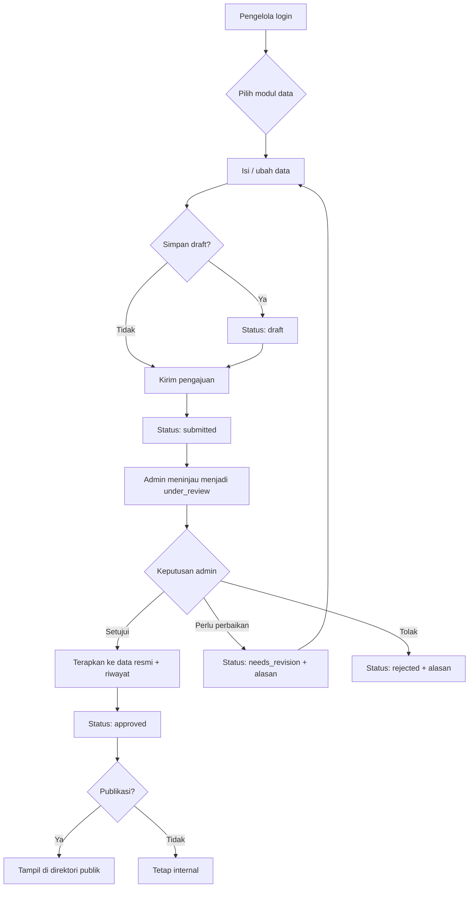
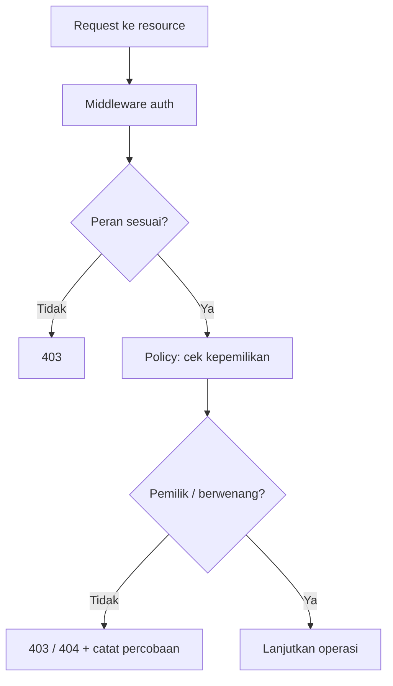
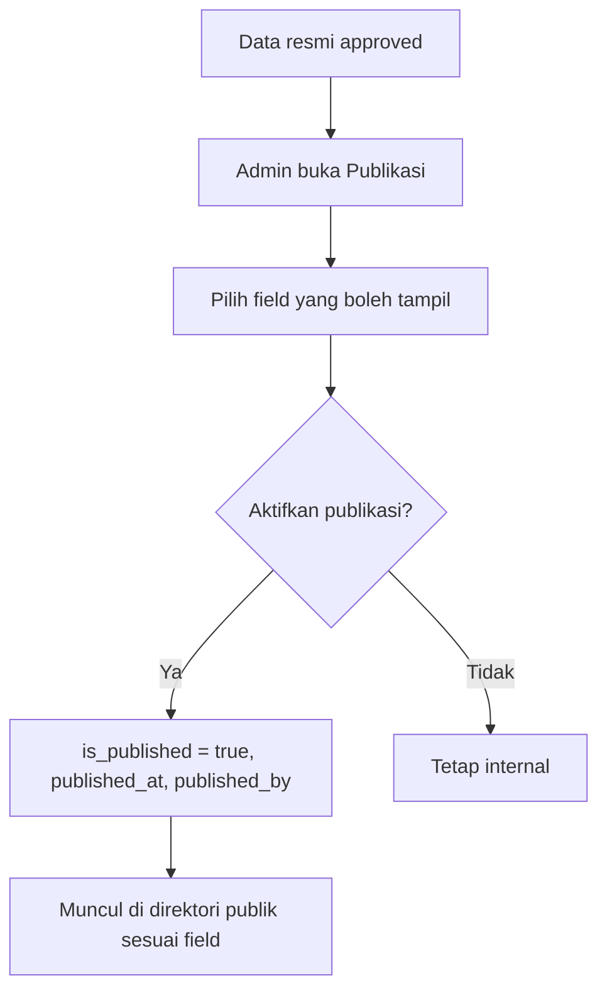

# User Flows

## Sistem Informasi Pendataan dan Pemantauan Koperasi Provinsi Jawa Barat

| Field | Value |
| --- | --- |
| Versi | 1.0 (draft) |
| Terkait | `docs/PRD.md` (§7, §8, §12) |
| Tujuan | Memetakan alur pengguna utama sebagai acuan desain UI & pengujian |

> Label: **[FAKTA]**, **[ASUMSI]**, **[REKOMENDASI]**, **[NEEDS CONFIRMATION]**, **[PROPOSED]**.

---

## 1. Konvensi

- **Aktor:** Admin Dinas, Pengelola Koperasi, Masyarakat (guest).
- **Status pengajuan:** `draft`, `submitted`, `under_review`, `needs_revision`, `approved`, `rejected`, `archived`.
- Setiap alur menyertakan: prasyarat, langkah, hasil, kondisi gagal, dan FR terkait.

---

## 2. Flow Admin Dinas

### FLOW-ADM-01 — Login ke dashboard
- **Prasyarat:** akun aktif dengan peran admin.
- **Langkah:** buka `/login` → isi email & password → submit.
- **Hasil:** diarahkan ke `/dashboard` (statistik & antrian pengajuan).
- **Gagal:** kredensial salah → pesan generik; akun nonaktif → pesan khusus; rate limit → coba lagi.
- **FR:** FR-001, FR-020, FR-021.

### FLOW-ADM-02 — Menambah/mengubah data koperasi
- **Prasyarat:** admin login.
- **Langkah:** menu Koperasi → Tambah/Ubah → isi form bertahap (identitas, wilayah, kontak) → simpan.
- **Hasil:** data tersimpan; tercatat di audit log.
- **Gagal:** nomor identitas duplikat → tolak; field invalid → error dekat field.
- **FR:** FR-040, FR-200, FR-150.

### FLOW-ADM-03 — Memverifikasi pengajuan (bahagia)
- **Prasyarat:** ada pengajuan berstatus `submitted`.
- **Langkah:** buka antrian → pilih pengajuan → sistem set `under_review` → bandingkan usulan vs data resmi → **Setujui**.
- **Hasil:** sistem menerapkan perubahan ke data resmi dalam transaksi DB; status `approved`; riwayat & audit tercatat; pengelola dinotifikasi.
- **Gagal:** konflik data → kembali `under_review` dengan catatan.
- **FR:** FR-141, FR-143, FR-150, FR-201.

### FLOW-ADM-04 — Menolak / minta perbaikan
- **Prasyarat:** pengajuan `under_review`.
- **Langkah:** pilih **Perlu perbaikan** atau **Tolak** → isi alasan (wajib) → submit.
- **Hasil:** status `needs_revision`/`rejected`; alasan tersimpan & tampil ke pengelola.
- **Gagal:** alasan kosong → validasi menolak.
- **FR:** FR-142.

### FLOW-ADM-05 — Mengelola dokumen
- **Langkah:** buka entitas (izin/aset) → unggah dokumen → validasi tipe/ukuran → simpan ke storage privat.
- **Hasil:** metadata tersimpan; berkas tidak dapat diakses publik.
- **Gagal:** tipe/ukuran salah → pesan spesifik.
- **FR:** FR-070, FR-071.

### FLOW-ADM-06 — Mengelola akun pengelola
- **Langkah:** menu Akun → buat akun pengelola → kaitkan ke koperasi → set status.
- **Hasil:** akun pengelola aktif & terhubung satu koperasi.
- **Gagal:** email duplikat → tolak; koperasi tidak ada → wajib pilih.
- **FR:** FR-010, BR-017.

### FLOW-ADM-07 — Mencatat hasil penilaian kesehatan (kewenangan resmi)
- **Langkah:** buka koperasi → Kesehatan → tambah periode → isi skor/predikat/penilai → set `final`.
- **Hasil:** tercatat per periode (unik koperasi+periode).
- **Gagal:** periode duplikat → tolak/arahkan revisi.
- **FR:** FR-080, BR-010.

### FLOW-ADM-08 — Publikasi informasi koperasi
- **Prasyarat:** data resmi (approved).
- **Langkah:** buka koperasi → Publikasi → pilih field yang boleh tampil → aktifkan `is_published` → simpan.
- **Hasil:** profil muncul di direktori publik sesuai field yang diizinkan.
- **Gagal:** data belum approved → tombol publikasi nonaktif.
- **FR:** FR-190, FR-191, BR-008, BR-020.

### FLOW-ADM-09 — Membuat laporan/ekspor
- **Langkah:** menu Laporan → pilih filter (wilayah/jenis/status/periode) → tampilkan/pratinjau → ekspor (jika tersedia).
- **Hasil:** rekap berbasis data terverifikasi; ekspor tercatat di audit log.
- **FR:** FR-170, FR-171, FR-151.

---

## 3. Flow Pengelola Koperasi

### FLOW-PGL-01 — Login & melihat profil
- **Prasyarat:** akun pengelola terhubung ke koperasi.
- **Langkah:** login → dashboard → Profil koperasi.
- **Hasil:** data resmi & status terlihat (read-only).
- **Gagal:** akun belum dikaitkan → halaman "akun belum terhubung, hubungi admin".
- **FR:** FR-041, FR-030.

### FLOW-PGL-02 — Memperbarui data (mengajukan perubahan)
- **Prasyarat:** pengelola login; koperasi terhubung.
- **Langkah:** pilih modul (mis. Aset) → isi/ubah field yang diizinkan → simpan draft → kirim.
- **Hasil:** pengajuan `submitted`; data resmi **tidak** berubah sampai approve.
- **Gagal:** field terlarang → ditolak; validasi → error dekat field.
- **FR:** FR-042, FR-140, FR-100, BR-009, BR-014.

### FLOW-PGL-03 — Mengunggah dokumen pendukung
- **Langkah:** pada pengajuan → unggah dokumen → validasi → simpan privat.
- **Hasil:** dokumen terkait pengajuan; hanya pengelola pemilik & admin yang bisa unduh.
- **Gagal:** tipe/ukuran salah → pesan spesifik.
- **FR:** FR-070, FR-071.

### FLOW-PGL-04 — Menindaklanjuti permintaan perbaikan
- **Prasyarat:** ada pengajuan `needs_revision`/`rejected`.
- **Langkah:** buka daftar perbaikan → baca alasan → perbaiki → kirim ulang (versi baru).
- **Hasil:** pengajuan baru `submitted`; riwayat pengajuan lama tetap tersimpan.
- **Gagal:** alasan belum terbaca tuntas → tetap tersedia di layar; revisi tidak mengubah data resmi.
- **FR:** FR-031, FR-142, FR-140.

### FLOW-PGL-05 — Melihat riwayat pengajuan
- **Langkah:** menu Riwayat → daftar pengajuan + status + waktu.
- **Hasil:** jejak pengajuan koperasi sendiri.
- **FR:** FR-150 (sisi pengelola), FR-011.

---

## 4. Flow Masyarakat (guest)

### FLOW-PUB-01 — Menelusuri direktori
- **Prasyarat:** tidak perlu login.
- **Langkah:** buka `/koperasi` → lihat daftar koperasi terpublikasi → buka profil.
- **Hasil:** hanya koperasi `is_published=true` & approved; field sensitif tidak tampil.
- **Gagal:** koperasi tidak dipublikasikan → tidak muncul (404 bila akses langsung).
- **FR:** FR-180, FR-182, BR-009.

### FLOW-PUB-02 — Mencari & memfilter
- **Langkah:** isi kata kunci (nama) → pilih jenis → pilih kabupaten/kota → submit.
- **Hasil:** hasil relevan dengan pagination.
- **Gagal:** tidak ada hasil → empty state + saran ubah filter.
- **FR:** FR-181, FR-200.

### FLOW-PUB-03 — Melihat statistik agregat
- **Prasyarat:** statistik publik diizinkan dinas **[NEEDS CONFIRMATION]**.
- **Langkah:** buka `/statistik` → lihat agregat (jumlah koperasi per jenis/wilayah).
- **Hasil:** angka agregat tanpa data pribadi.
- **FR:** FR-183, NFR-SEC-015.

---

## 5. Diagram alur (Mermaid)

### 5.1 Alur pengajuan & verifikasi (end-to-end)

### 5.2 Alur otorisasi & isolasi data

### 5.3 Alur publikasi

---

## 6. Matriks ringkas alur → FR

| Flow | Aktor | FR terkait |
| --- | --- | --- |
| FLOW-ADM-01 | Admin | FR-001, FR-020, FR-021 |
| FLOW-ADM-02 | Admin | FR-040, FR-150, FR-200 |
| FLOW-ADM-03 | Admin | FR-141, FR-143, FR-150, FR-201 |
| FLOW-ADM-04 | Admin | FR-142 |
| FLOW-ADM-05 | Admin | FR-070, FR-071 |
| FLOW-ADM-06 | Admin | FR-010 |
| FLOW-ADM-07 | Admin | FR-080 |
| FLOW-ADM-08 | Admin | FR-190, FR-191 |
| FLOW-ADM-09 | Admin | FR-170, FR-171, FR-151 |
| FLOW-PGL-01 | Pengelola | FR-041, FR-030 |
| FLOW-PGL-02 | Pengelola | FR-042, FR-140 |
| FLOW-PGL-03 | Pengelola | FR-070, FR-071 |
| FLOW-PGL-04 | Pengelola | FR-031, FR-142, FR-140 |
| FLOW-PGL-05 | Pengelola | FR-011 |
| FLOW-PUB-01 | Masyarakat | FR-180, FR-182 |
| FLOW-PUB-02 | Masyarakat | FR-181 |
| FLOW-PUB-03 | Masyarakat | FR-183 |
