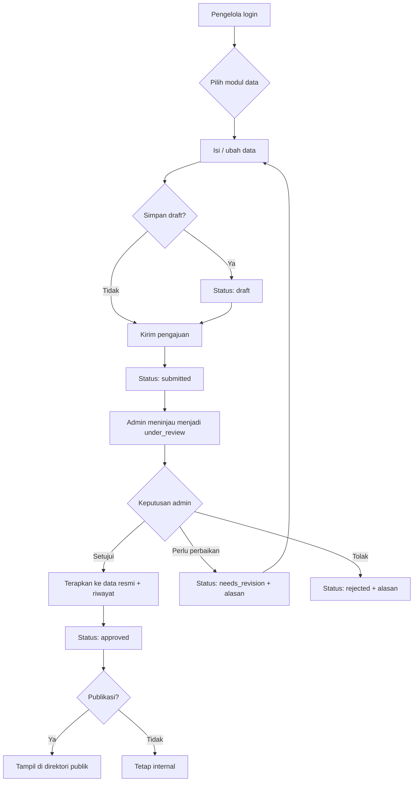
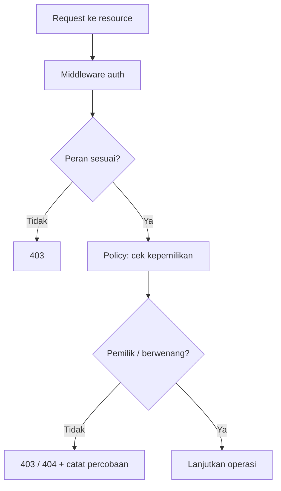
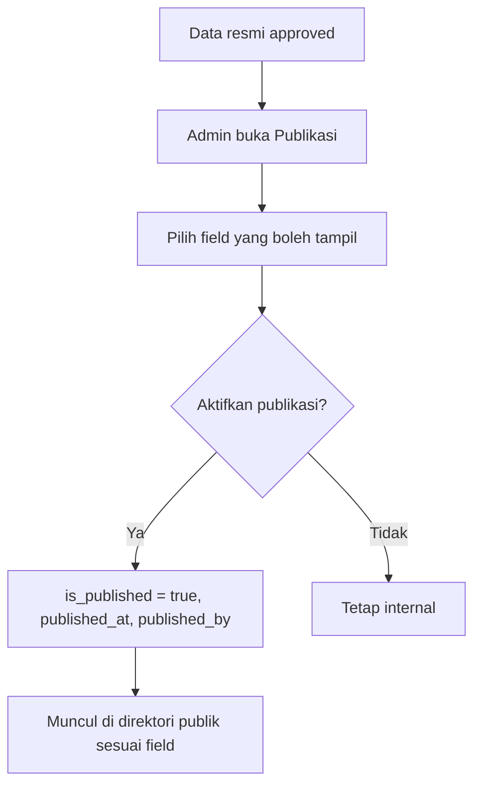

# User Flows

## Sistem Informasi Pendataan dan Pemantauan Koperasi Provinsi Jawa Barat

| Field | Value |
| --- | --- |
| Versi | 1.0 (draft) |
| Terkait | `docs/PRD.md` (§7, §8, §12) |
| Tujuan | Memetakan alur pengguna utama sebagai acuan desain UI & pengujian |

> Label: **[FAKTA]**, **[ASUMSI]**, **[REKOMENDASI]**, **[NEEDS CONFIRMATION]**, **[PROPOSED]**.

---

## 1. Konvensi

- **Aktor:** Admin Dinas, Pengelola Koperasi, Masyarakat (guest).
- **Status pengajuan:** `draft`, `submitted`, `under_review`, `needs_revision`, `approved`, `rejected`, `archived`.
- Setiap alur menyertakan: prasyarat, langkah, hasil, kondisi gagal, dan FR terkait.

> **Status F5 (16 Oktober 2026).** Alur pengajuan & verifikasi yang sudah diimplementasikan:
> FLOW-ADM-03/04 (verifikasi serta tolak/minta perbaikan) dan FLOW-PGL-02/04/05 (mengajukan,
> menindaklanjuti perbaikan, melihat riwayat). Status mengikuti PRD §12.2 (`needs_revision`, bukan
> `revision_requested`). Verifikasi sementara **satu tingkat** oleh admin (Q-004) dan whitelist
> modul/field sementara (Q-006, saat ini hanya `koperasi_induk`). Rincian: `docs/DECISIONS.md` §12.
>
> **Status FLOW-ADM-09:** laporan/rekap **FR-170** sudah diimplementasikan pada **F6** (filter
> wilayah/jenis/status/periode + rekap per wilayah/jenis/periode); **ekspor FR-171** masih **F8**
> dan belum diimplementasikan. FLOW-ADM-10/11/12 adalah alur **data periodik F4** (tata kelola,
> aset, riwayat keanggotaan) — **bukan** alur pengajuan/verifikasi.

---

## 2. Flow Admin Dinas

### FLOW-ADM-01 — Login ke dashboard
- **Prasyarat:** akun aktif dengan peran admin.
- **Langkah:** buka `/login` → isi email & password → submit.
- **Hasil:** diarahkan ke `/dashboard` (statistik & antrian pengajuan).
- **Gagal:** kredensial salah → pesan generik; akun nonaktif → pesan khusus; rate limit → coba lagi.
- **FR:** FR-001, FR-020, FR-021.

### FLOW-AUTH-01 — Lupa/reset password
- **Prasyarat:** akses ke email akun (self-service) atau akun admin aktif (kirim tautan).
- **Langkah:** buka `/lupa-password` → masukkan email → buka tautan email → isi password baru +
  konfirmasi → simpan. Admin dapat memicu tautan dari `/admin/akun`.
- **Hasil:** password baru tersimpan sebagai hash; password lama tidak berlaku; sesi lama diakhiri
  (driver database) dan tautan tidak dapat dipakai ulang.
- **Gagal:** email tidak terdaftar → pesan tetap generik; token salah/kedaluwarsa/dipakai ulang →
  minta tautan baru; password < 8 karakter atau konfirmasi beda → error validasi.
- **FR:** FR-004. **Batas lokal:** `MAIL_MAILER=log` (tautan di log, bukan email nyata).

### FLOW-AUTH-02 — Keamanan & sesi
- **Prasyarat:** pengguna login.
- **Langkah:** buka `/akun/keamanan` → lihat batas idle dan sesi aktif → pilih “Akhiri semua sesi
  lain” atau “Keluar dari semua perangkat”.
- **Hasil:** sesi lain dihapus; untuk “semua perangkat”, pengguna juga logout dan diarahkan ke login.
- **Gagal:** driver sesi bukan `database` → halaman menjelaskan bahwa daftar sesi lintas perangkat
  tidak tersedia (tidak ada klaim palsu); sesi idle > `SESSION_IDLE_TIMEOUT` → dipaksa login ulang.
- **FR:** FR-003.

### FLOW-ADM-02 — Menambah/mengubah data koperasi
- **Prasyarat:** admin login.
- **Langkah:** menu Koperasi → Tambah/Ubah → isi form bertahap (identitas, wilayah, kontak) → simpan.
- **Hasil:** data tersimpan; tercatat di audit log.
- **Gagal:** nomor identitas duplikat → tolak; field invalid → error dekat field.
- **FR:** FR-040, FR-200, FR-150.

### FLOW-ADM-03 — Memverifikasi pengajuan (bahagia)
- **Prasyarat:** ada pengajuan berstatus `submitted`.
- **Langkah:** buka antrian → pilih pengajuan → sistem set `under_review` → bandingkan usulan vs data resmi → **Setujui**.
- **Hasil:** sistem menerapkan perubahan ke data resmi dalam transaksi DB; status `approved`; riwayat & audit tercatat; pengelola dinotifikasi.
- **Gagal:** konflik data → kembali `under_review` dengan catatan.
- **FR:** FR-141, FR-143, FR-150, FR-201.

### FLOW-ADM-04 — Menolak / minta perbaikan
- **Prasyarat:** pengajuan `under_review`.
- **Langkah:** pilih **Perlu perbaikan** atau **Tolak** → isi alasan (wajib) → submit.
- **Hasil:** status `needs_revision`/`rejected`; alasan tersimpan & tampil ke pengelola.
- **Gagal:** alasan kosong → validasi menolak.
- **FR:** FR-142.

### FLOW-ADM-05 — Mengelola dokumen
- **Langkah:** buka entitas (izin/aset) → unggah dokumen → validasi tipe/ukuran → simpan ke storage privat.
- **Hasil:** metadata tersimpan; berkas tidak dapat diakses publik.
- **Gagal:** tipe/ukuran salah → pesan spesifik.
- **FR:** FR-070, FR-071.

### FLOW-ADM-06 — Mengelola akun pengelola
- **Langkah:** menu Akun → buat akun pengelola → kaitkan ke koperasi → set status.
- **Hasil:** akun pengelola aktif & terhubung satu koperasi.
- **Gagal:** email duplikat → tolak; koperasi tidak ada → wajib pilih.
- **FR:** FR-010, BR-017.

### FLOW-ADM-07 — Mencatat hasil penilaian kesehatan (kewenangan resmi)
- **Langkah:** buka koperasi → Kesehatan → tambah periode → isi skor/predikat/penilai → set `final`.
- **Hasil:** tercatat per periode (unik koperasi+periode).
- **Gagal:** periode duplikat → tolak/arahkan revisi.
- **FR:** FR-080, BR-010.

### FLOW-ADM-08 — Publikasi informasi koperasi
- **Prasyarat:** data resmi (approved).
- **Langkah:** buka koperasi → Publikasi → pilih field yang boleh tampil → aktifkan `is_published` → simpan.
- **Hasil:** profil muncul di direktori publik sesuai field yang diizinkan.
- **Gagal:** data belum approved → tombol publikasi nonaktif.
- **FR:** FR-190, FR-191, BR-008, BR-020.
- **Status final (24 Oktober 2026):** langkah "pilih field yang boleh tampil" tersedia di
  **Pengaturan Publik** (`/admin/pengaturan/publik`) untuk admin dinas, disimpan di tabel `settings`
  dan dibatasi allowlist Q-008. Field di luar Q-008 (NIK, telepon pribadi, data anggota, omzet
  terlarang) ditolak di server. Kelayakan ditentukan
  `config('koperasi.public.visible_statuses')` (saat ini `approved`), lalu admin dinas menekan
  **Publikasikan** (POST `/admin/koperasi/{cooperative}/publikasikan`) atau **Tarik publikasi**
  (POST `.../tarik-publikasi`); `published_at`/`published_by` diisi sistem.

### FLOW-ADM-09 — Membuat laporan/ekspor
- **Langkah:** menu Laporan → pilih filter (wilayah/jenis/status/periode) → tampilkan/pratinjau → ekspor (jika tersedia).
- **Hasil:** rekap berbasis data terverifikasi; ekspor tercatat di audit log.
- **FR:** FR-170, FR-171, FR-151.
- **Status (26 Oktober 2026):** tampilkan/pratinjau **FR-170 selesai** (hanya data `approved`, rekap
  per wilayah/jenis/periode). **Ekspor FR-171 selesai** dalam bentuk **CSV** (bukan Excel/PDF),
  mengikuti filter aktif, hanya data `approved`, dan setiap ekspor dicatat di `activity_logs`.
  Ekspor Excel/PDF memerlukan dependency baru dan belum disetujui.

### FLOW-ADM-10 — Mengelola data tata kelola (periodik)
> **PROVISIONAL — MENUNGGU KONFIRMASI DINAS (Q-010).** Periode untuk sementara **tahunan**; indikator
> (`meeting_count`, `summary`) hanyalah contoh, bukan indikator resmi.
- **Langkah:** buka koperasi → **Tata Kelola** → Tambah → isi tahun/periode/indikator → Simpan (draft/final internal).
- **Hasil:** catatan tersimpan per (`period_year`, `period`); satu catatan per periode (unik).
- **Gagal:** periode duplikat → tervalidasi tolak (AC-PER-01); field wajib kosong → error dekat field.
- **Arsip:** hapus = **soft delete** (data tidak dihapus permanen, BR-011).
- **FR:** FR-090.

### FLOW-ADM-11 — Mengelola data aset (snapshot periodik)
> **PROVISIONAL — MENUNGGU KONFIRMASI DINAS (Q-010).** Snapshot **tahunan**; `quantity`,
> `acquisition_date`, `condition` adalah kolom tambahan; tanpa integrasi akuntansi.
- **Langkah:** buka koperasi → **Aset** → Tambah → pilih tahun/periode, jenis aset, nilai → Simpan.
- **Hasil:** beberapa baris aset per periode; **periode berbeda tidak saling menimpa** (AC-PER-02).
- **Gagal:** nilai negatif / jenis kosong / kondisi tidak dikenal → tervalidasi tolak.
- **Arsip:** hapus = **soft delete** (BR-011).
- **FR:** FR-100, FR-101.

### FLOW-ADM-12 — Mengelola riwayat keanggotaan (per kejadian)
> **PROVISIONAL — MENUNGGU KONFIRMASI DINAS (Q-010).** Dicatat **per kejadian/perubahan**, bukan
> rekap tahunan. **Tidak** mengumpulkan data anggota individual/NIK.
- **Langkah:** buka koperasi → **Riwayat Keanggotaan** → Tambah → isi tanggal, jenis perubahan, jumlah bertambah/berkurang → Simpan.
- **Hasil:** daftar kejadian terurut terbaru-dulu + selisih bersih (AC-PER-03).
- **Gagal:** `event_date` melebihi hari ini → tolak; kedua jumlah kosong → tolak (minimal salah satu diisi).
- **Arsip:** hapus = **soft delete** (BR-011).
- **FR:** FR-110, FR-111.

### FLOW-ADM-13 — Mengelola akun pengelola
- **Prasyarat:** admin dinas login.
- **Langkah:** buka `/admin/akun` → cari/filter → Tambah/Ubah → pilih peran & koperasi → simpan;
  gunakan aksi **Aktifkan/Nonaktifkan** atau **Kirim reset**.
- **Hasil:** akun tersimpan dengan peran & tautan koperasi yang valid; password acak tidak pernah
  ditampilkan; tautan reset dikirim ke email akun. Aktivitas dicatat di audit log.
- **Gagal:** email duplikat / peran tidak dikenal / koperasi tidak ada → error validasi; admin mencoba
  mengubah peran atau menonaktifkan diri sendiri → ditolak; admin aktif terakhir tidak dapat
  dinonaktifkan.
- **FR:** US-009, FR-004, FR-151.

---

## 3. Flow Pengelola Koperasi

### FLOW-PGL-01 — Login & melihat profil
- **Prasyarat:** akun pengelola terhubung ke koperasi.
- **Langkah:** login → dashboard → Profil koperasi.
- **Hasil:** data resmi & status terlihat (read-only).
- **Gagal:** akun belum dikaitkan → halaman "akun belum terhubung, hubungi admin".
- **FR:** FR-041, FR-030.

### FLOW-PGL-02 — Memperbarui data (mengajukan perubahan)
- **Prasyarat:** pengelola login; koperasi terhubung.
- **Langkah:** pilih modul (**saat ini hanya “Data Induk Koperasi”**, `koperasi_induk`) → isi/ubah field yang diizinkan → simpan draft → kirim.
- **Hasil:** pengajuan `submitted`; data resmi **tidak** berubah sampai approve.
- **Gagal:** field terlarang → ditolak; validasi → error dekat field.
- **FR:** FR-042, FR-140, FR-100, BR-009, BR-014.

### FLOW-PGL-03 — Mengunggah dokumen pendukung
- **Langkah:** pada pengajuan → unggah dokumen → validasi → simpan privat.
- **Hasil:** dokumen terkait pengajuan; hanya pengelola pemilik & admin yang bisa unduh.
- **Gagal:** tipe/ukuran salah → pesan spesifik.
- **FR:** FR-070, FR-071.

### FLOW-PGL-04 — Menindaklanjuti permintaan perbaikan
- **Prasyarat:** ada pengajuan `needs_revision` (pengajuan `rejected` bersifat terminal — tidak dapat dikirim ulang).
- **Langkah:** buka daftar perbaikan → baca alasan → **buat versi perbaikan** (`create?revision={id}`) → perbaiki → **kirim versi baru**.
- **Hasil:** dibuat **pengajuan/versi baru** berstatus `submitted` yang tertaut ke versi induk lewat `parent_submission_id`; pengajuan lama tetap `needs_revision` dan **digantikan** (tidak lagi aktif), sehingga dapat dicatat sebagai riwayat. Hanya satu pengajuan aktif per koperasi + modul.
- **Gagal:** alasan belum terbaca tuntas → tetap tersedia di layar; revisi tidak mengubah data resmi; bila sudah ada pengajuan aktif lain untuk modul yang sama → ditolak dengan pesan; versi induk yang bukan `needs_revision` (atau sudah digantikan) → ditolak.
- **FR:** FR-031, FR-142, FR-140.
- **Catatan:** keputusan pemilik **D-1 opsi B** (lihat `docs/DECISIONS.md` §17.1) mengimplementasikan bunyi FR-031/FR-142 ("versi pengajuan baru"); catatan "belum diimplementasikan" pada versi dokumen sebelumnya sudah tidak berlaku.

### FLOW-PGL-05 — Melihat riwayat pengajuan
- **Langkah:** menu Riwayat → daftar pengajuan + status + waktu.
- **Hasil:** jejak pengajuan koperasi sendiri.
- **FR:** FR-150 (sisi pengelola), FR-011.

### FLOW-PGL-06 — Melihat data periodik koperasi sendiri (hanya baca)
> **PROVISIONAL — MENUNGGU KONFIRMASI DINAS (Q-010).** Penulisan oleh pengelola (via pengajuan, F5)
> belum tersedia; saat ini **read-only**. Kesehatan merupakan kewenangan admin (BR-010).
- **Prasyarat:** pengelola login; koperasi terhubung.
- **Langkah:** menu **Kesehatan / Tata Kelola / Aset / Anggota** → daftar (pagination) → **Detail**.
- **Hasil:** pengelola hanya melihat data **koperasinya sendiri**; tidak ada tombol tambah/ubah/arsip.
- **Gagal (otorisasi server-side):** membuka resource milik koperasi lain → **403** (Policy ownership);
  akun belum tertaut koperasi → 403; guest → redirect login. Menulis lewat route admin → **403** (middleware role).
- **FR:** FR-041/030 (profil), FR-080/090/100/110 (baca), BR-009, BR-014.

---

## 4. Flow Masyarakat (guest)

### FLOW-PUB-01 — Menelusuri direktori
- **Prasyarat:** tidak perlu login.
- **Langkah:** buka `/koperasi` → lihat daftar koperasi terpublikasi → buka profil.
- **Hasil:** hanya koperasi `is_published=true` & approved; field sensitif tidak tampil.
- **Gagal:** koperasi tidak dipublikasikan → tidak muncul (404 bila akses langsung).
- **FR:** FR-180, FR-182, BR-009.
- **Status (Tahap 86):** sudah diimplementasikan — route `publik.direktori` (`/koperasi`) dan
  `publik.koperasi` (`/koperasi/{slug}`), middleware `web` saja.

### FLOW-PUB-02 — Mencari & memfilter
- **Langkah:** isi kata kunci (nama) → pilih jenis → pilih kabupaten/kota → submit.
- **Hasil:** hasil relevan dengan pagination.
- **Gagal:** tidak ada hasil → empty state + saran ubah filter.
- **FR:** FR-181, FR-200.
- **Status (Tahap 86):** sudah diimplementasikan; nilai filter tak dikenal diabaikan (tidak menyesatkan),
  pilihan jenis/wilayah diturunkan dari data terpublikasi, dan pagination mempertahankan query string.

### FLOW-PUB-03 — Melihat statistik agregat
- **Prasyarat:** statistik publik diizinkan dinas **[NEEDS CONFIRMATION]**.
- **Langkah:** buka `/statistik` → lihat agregat (jumlah koperasi per jenis/wilayah).
- **Hasil:** angka agregat tanpa data pribadi.
- **FR:** FR-183, NFR-SEC-015.
- **Status (26 Oktober 2026):** FR-183 **selesai lokal** di F8. Route `/statistik` menampilkan
  agregat total koperasi terpublikasi, per kabupaten/kota, per jenis, dan per status operasional;
  hanya `is_published = true` + `status_verifikasi = approved`; tanpa data personal. Statistik
  bersifat informatif dan bukan laporan resmi dinas.

---

## 5. Diagram alur (Mermaid)

### 5.1 Alur pengajuan & verifikasi (end-to-end)

### 5.2 Alur otorisasi & isolasi data

### 5.3 Alur publikasi

---

## 6. Matriks ringkas alur → FR

| Flow | Aktor | FR terkait |
| --- | --- | --- |
| FLOW-ADM-01 | Admin | FR-001, FR-020, FR-021 |
| FLOW-ADM-02 | Admin | FR-040, FR-150, FR-200 |
| FLOW-ADM-03 | Admin | FR-141, FR-143, FR-150, FR-201 |
| FLOW-ADM-04 | Admin | FR-142 |
| FLOW-ADM-05 | Admin | FR-070, FR-071 |
| FLOW-ADM-06 | Admin | FR-010 |
| FLOW-ADM-07 | Admin | FR-080 |
| FLOW-ADM-08 | Admin | FR-190, FR-191 |
| FLOW-ADM-09 | Admin | FR-170, FR-171, FR-151 |
| FLOW-PGL-01 | Pengelola | FR-041, FR-030 |
| FLOW-PGL-02 | Pengelola | FR-042, FR-140 |
| FLOW-PGL-03 | Pengelola | FR-070, FR-071 |
| FLOW-PGL-04 | Pengelola | FR-031, FR-142, FR-140 |
| FLOW-PGL-05 | Pengelola | FR-011 |
| FLOW-PUB-01 | Masyarakat | FR-180, FR-182 |
| FLOW-PUB-02 | Masyarakat | FR-181 |
| FLOW-PUB-03 | Masyarakat | FR-183 |
